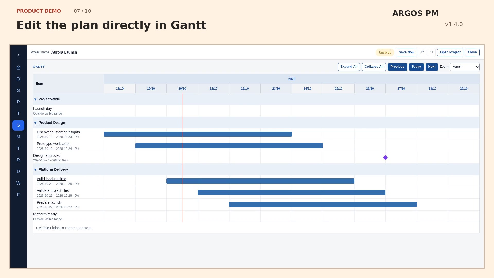

# ARGOS PM

A local-first ARGOS PM v1.4.0 built with TypeScript, React and Next.js. The authoritative product specification is maintained in [`docs/PROJECT_REQUIREMENTS.md`](docs/PROJECT_REQUIREMENTS.md), with architecture and implementation details in [`docs/ARCHITECTURE.md`](docs/ARCHITECTURE.md) and [`docs/IMPLEMENTATION_PLAN.md`](docs/IMPLEMENTATION_PLAN.md).

## One-minute product demo — v1.4.0

Create a local project, organise two streams and five tasks with five distinct owners, add shared milestones and risks, then edit the plan in Gantt and Tube Map. See a dependency conflict trigger a warning, correct its date and watch the warning clear.

[](https://github.com/anonapps/PM-POC/raw/refs/heads/main/docs/media/argos-pm-60s-demo-v1.4.0.mp4)

**[Watch or download the one-minute demo](https://github.com/anonapps/PM-POC/raw/refs/heads/main/docs/media/argos-pm-60s-demo-v1.4.0.mp4)** · 1920×1080 MP4 · 60 seconds · silent · real v1.4.0 browser excerpts at normal speed, with reading pauses and editorial chapter titles outside the product view.

The recording uses fictional data in a disposable project. The managed capture browser blocks native filesystem pickers, so the recording uses the existing isolated picker test harness; the resulting `.pmp` was exported and verified. Native OS picker consent is not demonstrated. See the [production and verification notes](docs/V1.4_DEMO_VERIFICATION.md).

[Archived v1.3.0 recording](https://github.com/anonapps/PM-POC/raw/refs/heads/main/docs/media/pm-poc-30s-demo-v1.3.0.mp4) · retained unchanged as historical footage.

## UI reference manual

Learn the consistent names for every page, region and control in the [illustrated UI reference manual](docs/ARGOS_PM_UI_REFERENCE.md): 85 terminology entries and 42 screenshots covering all workspace pages, creation forms, selectors, popovers, dialogs and feedback states. Download the [PDF](docs/ARGOS_PM_UI_REFERENCE.pdf) or [editable Word document](docs/ARGOS_PM_UI_REFERENCE.docx).

## Prerequisites

- Node.js 20.9 or newer for the app; Node.js 22 or newer for the browser test harness
- npm 10 or newer
- Chrome Desktop for the supported browser runtime and E2E acceptance suite

## Local development

```bash
npm ci
npm run dev
```

Open `http://localhost:3000` in Chrome Desktop.

## Validation

Run the complete regression gate before considering a change complete:

```bash
npm ci
npm test
npm run typecheck
npm run lint
npm run build
npm audit --omit=dev --audit-level=moderate
npm run test:regression
```

The regression suite includes 30 streams, people, tasks, milestones, risks and decisions (180 varied records). `npm run test:e2e` runs the original smoke flow; `npm run test:regression` adds the large dataset; `npm run test:lifecycle` also creates 30 additional records per module through the UI. See [`docs/AUTOMATED_REGRESSION.md`](docs/AUTOMATED_REGRESSION.md) for scenarios, CI triggers and commands, and [`docs/ACCEPTANCE_TESTING.md`](docs/ACCEPTANCE_TESTING.md) for native file-picker checks.

The 11 October 2026 regression baseline passed 27 Vitest files / 139 tests, TypeScript, lint, production build, dependency checks and both Chrome browser suites. Test counts are a dated validation result, not a fixed coverage target. The production audit is blocking; the full development audit is informational in CI.

## Source layout

- `src/app` — Next.js entry points and global presentation styles.
- `src/features` — feature-oriented React UI.
- `src/application` — framework-independent use cases and state orchestration.
- `src/domain` — framework- and platform-independent business rules.
- `src/persistence` — `.pmp` codec, validation and Project File Service adapters.
- `src/runtime` — local project runtime/session coordination.
- `src/shared` — small cross-cutting constants and utilities.
- `src/testing` — deterministic regression fixture and coverage/lifecycle assertions.
- `e2e` — Chrome DevTools Protocol smoke, extended and full creation harnesses.

## Persistence model

The `.pmp` project file is the sole source of truth for project data. Persistence remains behind the Project File Service abstraction. The application does not depend on cloud storage, a database, browser local storage or an application backend for project data.

## POC status

Implementation Blocks 0–20 are complete. Automated unit/integration validation and the end-to-end Chrome acceptance flow are green. Native operating-system file-picker consent remains a deliberately manual browser/OS boundary; its checks are documented in [`docs/ACCEPTANCE_TESTING.md`](docs/ACCEPTANCE_TESTING.md).

## v1.4.0 — ARGOS PM release

Version 1.4.0 introduces streamlined sidebar navigation and page titles; Gantt and Tube Map quick editing, stream sorting and expanded-by-default lanes; consistent scope pills, table sorting, spacing and risk-level colours; optional People Role and Notes; project-wide progress visibility preference; and optional bounded audit history (5,000 retained events, 50 visible at once, searchable and CSV-exportable, with Undo/Redo events). People name edits commit on blur rather than per keystroke. The portable `.pmp` format and offline project-data model remain unchanged in principle. See [v1.4 approved scope](docs/V1.4_APPROVED_ENHANCEMENTS.md), [release acceptance](docs/V1.4_ACCEPTANCE_REVIEW.md), and [demo production brief](docs/V1.4_DEMO_PRODUCTION.md).

Both v1.4 validation and PM-POC validation passed for release PR #9 head `32093a9`; merged to `main` as `22f68a7`. Manual visual checks remain documented separately. The production-only dependency audit passed; the full dependency audit reported five high-severity findings involving development dependencies.

## v1.3.1 — HeroUI release

The tested HeroUI presentation is now the main baseline: dark navigation, a compact letter rail with left/right chevrons, improved controls and live entity selection lists. It uses HeroUI 2.8.10 and Tailwind 4.3.3, bundled locally. Run `git switch main`, `git pull --ff-only origin main`, `npm ci` and `npm run dev` to update your local runtime. No hosted service is required.

## v1.3.0 — UI design system

Version 1.3.0 introduces shared visual tokens, content-sized shell layout and measured sticky toolbar offsets. See [UI_DESIGN_SYSTEM.md](docs/UI_DESIGN_SYSTEM.md) for the scoped changes and browser validation.
