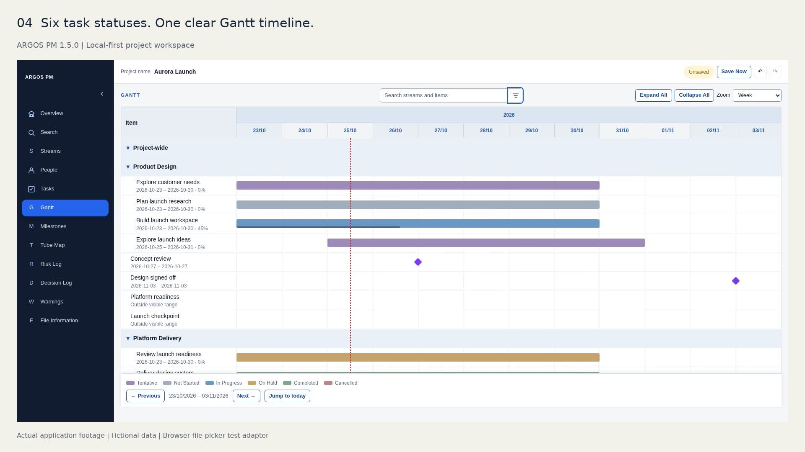

# ARGOS PM

A local-first ARGOS PM v1.6.0 built with TypeScript, React and Next.js. The authoritative product specification is maintained in [`docs/PROJECT_REQUIREMENTS.md`](docs/PROJECT_REQUIREMENTS.md), with architecture and implementation details in [`docs/ARCHITECTURE.md`](docs/ARCHITECTURE.md) and [`docs/IMPLEMENTATION_PLAN.md`](docs/IMPLEMENTATION_PLAN.md).

## v1.6.0

Viewport-fitting record layouts, multiple named immutable schedule baselines, shared date comparison, Gantt historical overlays, Tube Map historical milestone indicators and a cross-stream dependency inspection/editing workspace. Data stays in the local `.pmp` file; warnings never schedule automatically.

Extended Gantt adds a resizable compact chart/Tasks split using the existing modules. Its Add Task panel exactly matches standalone Tasks. The owner approved the [design](docs/V1.6_EXTENDED_MODE_MOCKUP.md) with that condition; implementation and regression evidence are in the phase report. See the [user guide](docs/V1.6_UI_REFERENCE.md), [implementation specification](docs/V1.6_IMPLEMENTATION.md) and [phase/test report](docs/V1.6_PROGRESS.md). The v1.6.0 publication follows owner acceptance of the final UI and explicit release direction. See [release notes](docs/releases/v1.6.0.md) and the [UI contributor guide](src/ui/README.md). The video below remains the v1.5 demonstration; no v1.6 footage is implied.

## Product demo — ARGOS PM v1.5.0

[](https://anonapps.github.io/PM-POC/videos/latest/)

**[Watch Video](https://anonapps.github.io/PM-POC/videos/latest/)** · 78 seconds 

## v1.5 documentation and acceptance

The v1.5 release includes shared search and filtering, anchored pickers, updated creation and editing, a task-only Tentative status, Gantt task-status colours and filtering, Tube Map milestone-status filtering and a compact legend, collapsible Risk Matrix, and consistent opaque sticky toolbars and timeline footers. The final two toolbar and Tube Map fixes were visually accepted on 25 October 2026.

- [v1.5 approved requirements](docs/V1.5_APPROVED_ENHANCEMENTS.md)
- [v1.5 release readiness and validation](docs/V1.5_RELEASE_READINESS.md)
- [v1.5 desktop acceptance guide](docs/V1.5_DESKTOP_ACCEPTANCE.md)
- [v1.5 native file compatibility guide](docs/V1.5_COMPATIBILITY.md)
- [v1.5 demo production brief](docs/V1.5_DEMO_PRODUCTION.md)

[Latest GitHub release](https://github.com/anonapps/PM-POC/releases/latest) · [Archived v1.4 demo](docs/media/argos-pm-60s-demo-v1.4.0.mp4). Historical footage remains unchanged. Physical Windows/macOS native permission checks are documented separately; this release does not claim those checks were performed.

## UI reference manual

Use the current [v1.5 UI Reference Manual](docs/V1.5_UI_REFERENCE.md) and [versioned PDF](public/manuals/1.5/ARGOS_PM_UI_REFERENCE.pdf), also bundled in File Information. The [earlier illustrated reference](docs/ARGOS_PM_UI_REFERENCE.md) remains an archive.

## Quick start — first run (macOS / Terminal)

You need [Node.js](https://nodejs.org/) 20.9+ (including npm), [Git](https://git-scm.com/) and desktop Chrome. ARGOS PM runs locally; these commands do not deploy it to a server.

1. **Download the repository.** Open Terminal and run:

   ```bash
   git clone https://github.com/anonapps/PM-POC.git
   cd PM-POC
   ```

   Alternatively, use **Code → Download ZIP** on GitHub, extract it, and open Terminal in the extracted folder.

2. **Install dependencies and start ARGOS PM.** From the `PM-POC` folder, run:

   ```bash
   npm ci
   npm run dev
   ```

3. **Open Chrome** at **http://localhost:3000** (or the Local URL printed by Next.js if port 3000 is in use). Keep Terminal running while using the application.

4. **Stop** the local server with **Ctrl+C** in Terminal.

**Returning later:** open Terminal, run `cd ~/PM-POC` (if cloned into your home folder), then `npm run dev`. You do not need to reinstall dependencies for every launch.

**Get the latest version:** in the repository folder, check `git status --short` first. If there are no local changes, run `git switch main`, `git pull --ff-only origin main`, and `npm ci` before `npm run dev`. If Git reports local changes or a conflict, stop rather than resetting or discarding files.

**Troubleshooting:** `npm` not found means Node.js/npm needs installing. A `package.json` not found error means Terminal is not inside the project folder. Type `npm run dev` exactly (without a trailing `~`). The `#` explanation lines in examples are not commands. A non-blocking dependency deprecation warning does not by itself mean installation failed.

Project data stays in your local `.pmp` files. Keep backups of important project files.

## Prerequisites

- Node.js 20.9 or newer for the app; Node.js 22 or newer for the browser test harness
- npm 10 or newer
- Chrome Desktop for the supported browser runtime and E2E acceptance suite

## Local development

```bash
npm ci
npm run dev
```

Open `http://localhost:3000` in Chrome Desktop.

## Validation

Run the complete regression gate before considering a change complete:

```bash
npm ci
npm test
npm run typecheck
npm run lint
npm run build
npm audit --omit=dev --audit-level=moderate
npm run test:regression
npm run test:lifecycle
```

The regression suite includes 30 streams, people, tasks, milestones, risks and decisions (180 varied records). `npm run test:e2e` runs the original smoke flow; `npm run test:regression` adds the large dataset; `npm run test:lifecycle` also creates 30 additional records per module through the UI. See [`docs/AUTOMATED_REGRESSION.md`](docs/AUTOMATED_REGRESSION.md) for scenarios, CI triggers and commands, and [`docs/ACCEPTANCE_TESTING.md`](docs/ACCEPTANCE_TESTING.md) for native file-picker checks.

The 11 October 2026 regression baseline passed 27 Vitest files / 139 tests, TypeScript, lint, production build, dependency checks and both Chrome browser suites. Test counts are a dated validation result, not a fixed coverage target. The production audit is blocking; the full development audit is informational in CI.

## Source layout

- `src/app` — Next.js entry points and global presentation styles.
- `src/features` — feature-oriented React UI.
- `src/application` — framework-independent use cases and state orchestration.
- `src/domain` — framework- and platform-independent business rules.
- `src/persistence` — `.pmp` codec, validation and Project File Service adapters.
- `src/runtime` — local project runtime/session coordination.
- `src/shared` — small cross-cutting constants and utilities.
- `src/testing` — deterministic regression fixture and coverage/lifecycle assertions.
- `e2e` — Chrome DevTools Protocol smoke, extended and full creation harnesses.

## Persistence model

The `.pmp` project file is the sole source of truth for project data. Persistence remains behind the Project File Service abstraction. The application does not depend on cloud storage, a database, browser local storage or an application backend for project data.


## UI standardization proposal

The documentation-only [Stage 1 proposal](docs/UI_STANDARD_PROPOSAL.md) captures the [current UI audit](docs/UI_STANDARD_AUDIT.md), reusable component contracts and a [sequenced migration/acceptance plan](docs/UI_STANDARD_MIGRATION_PLAN.md). Proposed token normalization is not yet approved; current requirements and accepted UI remain the reference.

### Internal UI catalogue

Run `npm run ui:catalogue` for the separate local component review app. See the [catalogue guide](tools/ui-catalogue/README.md) and [component contracts](docs/UI_COMPONENT_CONTRACTS.md). Production pages and approved visual values remain unchanged.

For UI changes, use the [initial token inventory](docs/UI_TOKEN_INVENTORY.md) and [style ownership map](docs/UI_STYLE_OWNERSHIP.md) to locate existing assets and rules before adding a new override.
