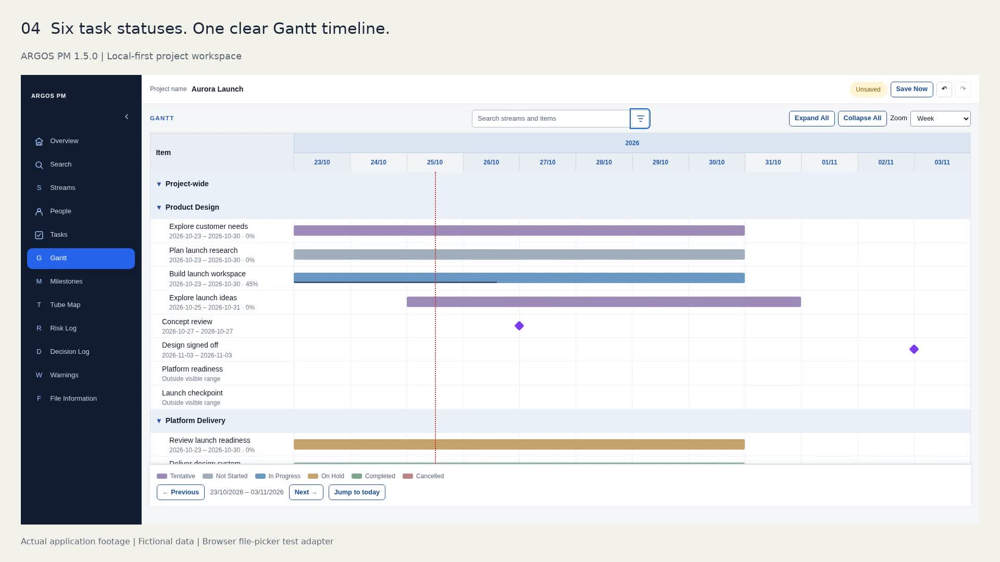

# ARGOS PM

A local-first ARGOS PM v1.7.0 workspace built with TypeScript, React and Next.js. Project data stays in a self-contained local `.pmp` file. The authoritative [requirements](docs/PROJECT_REQUIREMENTS.md), [architecture](docs/ARCHITECTURE.md) and [implementation record](docs/IMPLEMENTATION_PLAN.md) describe its boundaries.

## Current v1.7 content

The owner-tested consolidated UI and Tube Map accessibility correction were integrated into `main` through [PR #34](https://github.com/anonapps/PM-POC/pull/34), squash commit `9266a02`, on 12 November 2026. Version 1.7.0 is available from main; that merge did not create a tag, GitHub release or deployment.

- Local Critical Path Analysis in Extended Gantt, with project/stream scope, calculated dates/float, reliability warnings, task reveal, Quick Edit and CSV. Planned dates are never automatically changed.
- Named immutable baselines, comparison dates/variance, Gantt historical tooltips and Combined/Detached Tube Map comparison. Same-day historical targets remain pointer/keyboard accessible with names hidden.
- Settings replaces the visible File Information label and contains Project Details, file operations, Audit Log and the manual. The sidebar shows project/save status; global actions use a floating toolbar (Alt+Shift+T).
- Preserved record workflows, shared compact actions/dialogs, search-result navigation, filters, current milestone editing, dependencies, Undo/Redo and PMP compatibility.

Start with the [user manual](docs/USER_MANUAL.md), [complete v1.7 reference](docs/V1.7_UI_REFERENCE.md), [UI guide](docs/ARGOS_PM_UI_REFERENCE.md), [PDF](public/manuals/1.7/ARGOS_PM_UI_REFERENCE.pdf) or [Word manual](docs/ARGOS_PM_UI_REFERENCE.docx). The [documentation index](docs/README.md) separates current guidance, engineering references and historical evidence. See [v1.7 change notes](docs/releases/v1.7.0.md) and the [readiness register](docs/V1.7_RELEASE_READINESS.md) for dated acceptance/CI scope.

## Product demo — ARGOS PM v1.5.0

[](https://anonapps.github.io/PM-POC/videos/latest/)

**[Watch Video](https://anonapps.github.io/PM-POC/videos/latest/)** · 78 seconds 

## v1.5 documentation and acceptance

The v1.5 release includes shared search and filtering, anchored pickers, updated creation and editing, a task-only Tentative status, Gantt task-status colours and filtering, Tube Map milestone-status filtering and a compact legend, collapsible Risk Matrix, and consistent opaque sticky toolbars and timeline footers. The final two toolbar and Tube Map fixes were visually accepted on 25 October 2026.

- [v1.5 approved requirements](docs/V1.5_APPROVED_ENHANCEMENTS.md)
- [v1.5 release readiness and validation](docs/V1.5_RELEASE_READINESS.md)
- [v1.5 desktop acceptance guide](docs/V1.5_DESKTOP_ACCEPTANCE.md)
- [v1.5 native file compatibility guide](docs/V1.5_COMPATIBILITY.md)
- [v1.5 demo production brief](docs/V1.5_DEMO_PRODUCTION.md)

[Latest GitHub release](https://github.com/anonapps/PM-POC/releases/latest) · [Archived v1.4 demo](docs/media/argos-pm-60s-demo-v1.4.0.mp4). Historical footage remains unchanged. Physical Windows/macOS native permission checks are documented separately; this release does not claim those checks were performed.

## UI reference manual

Open **Settings → UI Reference Manual** for the bundled [v1.7 manual](docs/V1.7_UI_REFERENCE.md). The generic [UI guide](docs/ARGOS_PM_UI_REFERENCE.md) and PDF/Word downloads now cover v1.7. Earlier [v1.4 illustrated material](docs/V1.4_UI_REFERENCE.md) and versioned v1.5/v1.6 manuals remain historical references. The app retains its unpublished-candidate label until a v1.7 release is explicitly published.

## Quick start — first run (macOS / Terminal)

You need [Node.js](https://nodejs.org/) 20.9+ (including npm), [Git](https://git-scm.com/) and desktop Chrome. ARGOS PM runs locally; these commands do not deploy it to a server.

1. **Download the repository.** Open Terminal and run:

   ```bash
   git clone https://github.com/anonapps/PM-POC.git
   cd PM-POC
   ```

   Alternatively, use **Code → Download ZIP** on GitHub, extract it, and open Terminal in the extracted folder.

2. **Install dependencies and start ARGOS PM.** From the `PM-POC` folder, run:

   ```bash
   npm ci
   npm run dev
   ```

3. **Open Chrome** at **http://localhost:3000** (or the Local URL printed by Next.js if port 3000 is in use). Keep Terminal running while using the application.

4. **Stop** the local server with **Ctrl+C** in Terminal.

**Returning later:** open Terminal, run `cd ~/PM-POC` (if cloned into your home folder), then `npm run dev`. You do not need to reinstall dependencies for every launch.

**Get the latest version:** in the repository folder, check `git status --short` first. If there are no local changes, run `git switch main`, `git pull --ff-only origin main`, and `npm ci` before `npm run dev`. If Git reports local changes or a conflict, stop rather than resetting or discarding files.

**Troubleshooting:** `npm` not found means Node.js/npm needs installing. A `package.json` not found error means Terminal is not inside the project folder. Type `npm run dev` exactly (without a trailing `~`). The `#` explanation lines in examples are not commands. A non-blocking dependency deprecation warning does not by itself mean installation failed.

Project data stays in your local `.pmp` files. Keep backups of important project files.

## Prerequisites

- Node.js 20.9 or newer for the app; Node.js 22 or newer for the browser test harness
- npm 10 or newer
- Chrome Desktop for the supported browser runtime and E2E acceptance suite

## Local development

```bash
npm ci
npm run dev
```

Open `http://localhost:3000` in Chrome Desktop.

## Validation

Choose the smallest relevant suite from [Testing optimisation](docs/TESTING_OPTIMISATION.md). Documentation-only updates need link/asset checks and manual regeneration; do not repeat application/browser suites unless changed behavior warrants them.

```bash
npm run test:targeted -- unit src/shared/ui-manual.test.ts
npm run test:targeted -- layout e2e/layout/tube-display.spec.ts
npm run typecheck
npm run lint
```

For a ready application PR use `npm run validate:pr`; release verification uses `npm run validate:release`. These commands own the complete unit, build, lifecycle, layout and audit stages; avoid overlapping aliases. Browser validation requires Node.js 22+ and local Chrome/Chromium (set `CHROME_PATH` if needed). Never run browser suites concurrently against the same server/profile. Validation does not authorize a release or deployment.

Main-targeted PRs run `.github/workflows/validate.yml`, including the required `lifecycle-release-gate`. The final PR #34 [validation run](https://github.com/anonapps/PM-POC/actions/runs/43238733691) passed both jobs on `52acf02` before merge. Its focused fix checks passed 52 unit cases and 13 Tube Map browser cases; these are dated results, not fixed coverage totals. See [automated regression](docs/AUTOMATED_REGRESSION.md) and [acceptance/native-file checks](docs/ACCEPTANCE_TESTING.md). Production audits block at the configured threshold; full development audit is informational under the existing policy.

## Source layout

- `src/app` — Next.js entry points and global presentation styles.
- `src/features` — feature-oriented React UI.
- `src/application` — framework-independent use cases and state orchestration.
- `src/domain` — framework- and platform-independent business rules.
- `src/persistence` — `.pmp` codec, validation and Project File Service adapters.
- `src/runtime` — local project runtime/session coordination.
- `src/shared` — small cross-cutting constants and utilities.
- `src/testing` — deterministic regression fixture and coverage/lifecycle assertions.
- `e2e` — Chrome DevTools Protocol smoke, extended and full creation harnesses.

## Persistence model

The `.pmp` project file is the sole source of truth for project data. Persistence remains behind the Project File Service abstraction. The application does not depend on cloud storage, a database, browser local storage or an application backend for project data.


## UI contribution and catalogue

Use the [UI contributor guide](src/ui/README.md), [current design system](docs/UI_DESIGN_SYSTEM.md), [component contracts](docs/UI_COMPONENT_CONTRACTS.md), [token inventory](docs/UI_TOKEN_INVENTORY.md) and [style ownership map](docs/UI_STYLE_OWNERSHIP.md) before changing a shared control. Existing approved requirements and working behavior take precedence over historical normalization proposals.

Run `npm run ui:catalogue` for the separate local component review app; see its [guide](tools/ui-catalogue/README.md). The earlier [Stage 1 proposal](docs/UI_STANDARD_PROPOSAL.md), [audit](docs/UI_STANDARD_AUDIT.md) and [migration record](docs/UI_STANDARD_MIGRATION_PLAN.md) retain their dated design decisions/evidence.
