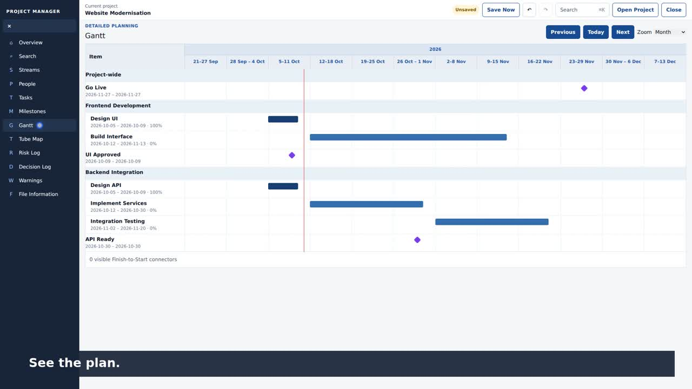

# Project Management POC

A local-first Project Management POC v1.3.0 built with TypeScript, React and Next.js. The authoritative product specification is maintained in [`docs/PROJECT_REQUIREMENTS.md`](docs/PROJECT_REQUIREMENTS.md), with architecture and implementation details in [`docs/ARCHITECTURE.md`](docs/ARCHITECTURE.md) and [`docs/IMPLEMENTATION_PLAN.md`](docs/IMPLEMENTATION_PLAN.md).

## 30-second product demo

See PM-POC in action before running it locally: create a project, organise two streams and five tasks, add people, milestones and risks, then explore the Gantt and Tube Map.

[](https://github.com/anonapps/PM-POC/raw/refs/heads/main/docs/media/pm-poc-30s-demo-v1.3.0.mp4)

**[Watch or download the 30-second demo](https://github.com/anonapps/PM-POC/raw/refs/heads/main/docs/media/pm-poc-30s-demo-v1.3.0.mp4)** · 1080p MP4 · v1.3.0 · accelerated real interactions, captions and original instrumental audio.

The recording uses fictional data in a separate local project. Ownership is demonstrated for streams and milestones.

## Prerequisites

- Node.js 20.9 or newer for the app; Node.js 22 or newer for the browser test harness
- npm 10 or newer
- Chrome Desktop for the supported browser runtime and E2E acceptance suite

## Local development

```bash
npm ci
npm run dev
```

Open `http://localhost:3000` in Chrome Desktop.

## Validation

Run the complete regression gate before considering a change complete:

```bash
npm ci
npm test
npm run typecheck
npm run lint
npm run build
npm audit --omit=dev --audit-level=moderate
npm run test:regression
```

The regression suite includes 30 streams, people, tasks, milestones, risks and decisions (180 varied records). `npm run test:e2e` runs the original smoke flow; `npm run test:regression` adds the large dataset; `npm run test:lifecycle` also creates 30 additional records per module through the UI. See [`docs/AUTOMATED_REGRESSION.md`](docs/AUTOMATED_REGRESSION.md) for scenarios, CI triggers and commands, and [`docs/ACCEPTANCE_TESTING.md`](docs/ACCEPTANCE_TESTING.md) for native file-picker checks.

The 11 October 2026 regression baseline passed 27 Vitest files / 139 tests, TypeScript, lint, production build, dependency checks and both Chrome browser suites. Test counts are a dated validation result, not a fixed coverage target. The production audit is blocking; the full development audit is informational in CI.

## Source layout

- `src/app` — Next.js entry points and global presentation styles.
- `src/features` — feature-oriented React UI.
- `src/application` — framework-independent use cases and state orchestration.
- `src/domain` — framework- and platform-independent business rules.
- `src/persistence` — `.pmp` codec, validation and Project File Service adapters.
- `src/runtime` — local project runtime/session coordination.
- `src/shared` — small cross-cutting constants and utilities.
- `src/testing` — deterministic regression fixture and coverage/lifecycle assertions.
- `e2e` — Chrome DevTools Protocol smoke, extended and full creation harnesses.

## Persistence model

The `.pmp` project file is the sole source of truth for project data. Persistence remains behind the Project File Service abstraction. The application does not depend on cloud storage, a database, browser local storage or an application backend for project data.

## POC status

Implementation Blocks 0–20 are complete. Automated unit/integration validation and the end-to-end Chrome acceptance flow are green. Native operating-system file-picker consent remains a deliberately manual browser/OS boundary; its checks are documented in [`docs/ACCEPTANCE_TESTING.md`](docs/ACCEPTANCE_TESTING.md).

## v1.3.0 — UI design system

Version 1.3.0 introduces shared visual tokens, content-sized shell layout and measured sticky toolbar offsets. See [UI_DESIGN_SYSTEM.md](docs/UI_DESIGN_SYSTEM.md) for the scoped changes and browser validation.
