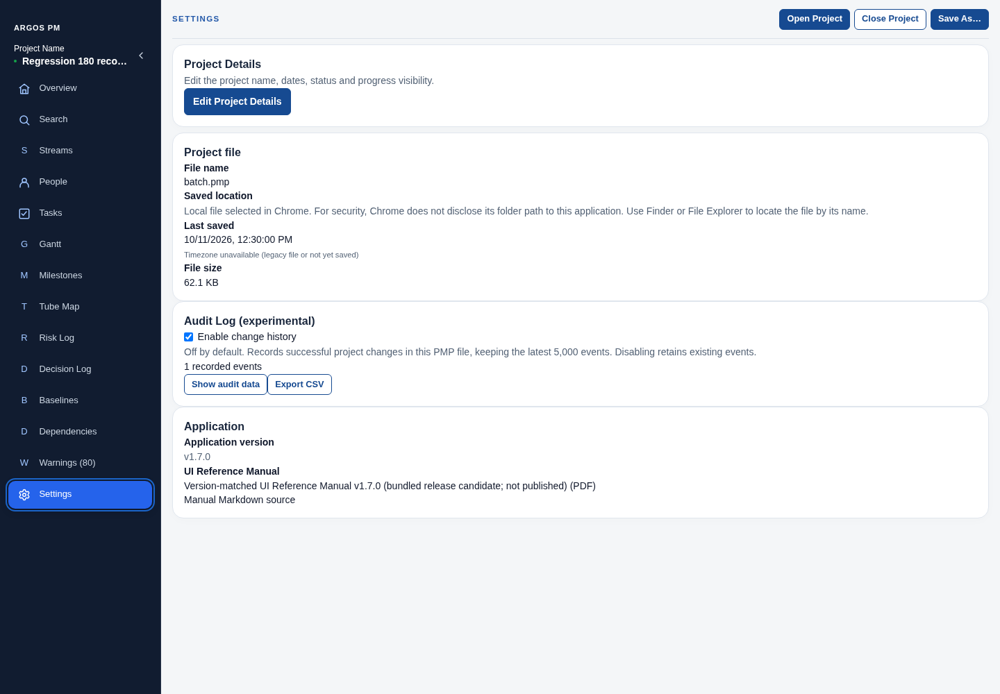

# ARGOS PM v1.7 — UI guide

Updated 12 November 2026 for `main` after [PR #34](https://github.com/anonapps/PM-POC/pull/34), squash commit `9266a02`. This describes current controls, not a new tagged release.

Use the [complete v1.7 user manual](V1.7_UI_REFERENCE.md) for operating instructions, [PDF](ARGOS_PM_UI_REFERENCE.pdf) or [editable Word manual](ARGOS_PM_UI_REFERENCE.docx) for offline reading, and the [documentation index](README.md) for technical/evidence guides. The [v1.4 illustrated reference](V1.4_UI_REFERENCE.md) is archived with its original screenshots and downloads.

## Name the interface precisely

Report issues as **page → region → record ID → control → expected behavior**. Prefer stable human-readable IDs such as TASK-002 over editable names.

| Region or control | Current location / behavior |
| --- | --- |
| Sidebar | Project name and save dot below ARGOS PM; collapsible page navigation. Up/Down traverses focused page buttons; Tab enters the page Search/first control. |
| Project actions | Floating top-right toolbar, revealed from the thin top edge or Alt+Shift+T; Save Now, Undo, Redo and save feedback. |
| Settings | Sidebar page formerly labelled File Information. Project Details is at the top; file actions, metadata, Audit Log and manual remain here. |
| Page toolbar | Module title, centered live Search, filter trigger and page actions. Narrow workspaces use the established wrap behavior. |
| Filter popup | Attached to Search; current page options, selected categories and Clear all. Chart visibility controls live here. |
| Record row | Stable human ID/name, editable fields, scope/owner/dependency selectors and compact action icons. |
| Creation drawer | Right-side Add/Create form with required fields, validation and visible Create/Cancel; Tasks and Extended Tasks use the same drawer. |
| Context / Actions | Message-bubble / lightning-bolt buttons; Actions retains its count, including zero. |
| Duplicate / Inspect-Edit / Delete | Copy / pencil / trash controls with accessible labels. Successful duplicate/delete feedback lasts about 600ms. |
| Scope summary | Milestones shows first active stream plus +N; either opens the existing selector. |
| Tooltip | Shared light-grey app surface. Repeating non-chart text appears only when clipped; action/explanation and rich chart details remain available on hover/focus. |
| Quick Edit | Anchored task/milestone editor; Save changes the live record, Cancel leaves it unchanged. Historical markers remain read-only. |
| Timeline navigation | Legend and Previous/Next/Jump to today; Gantt also keeps Zoom here. |

## Page map

| Page | Main work |
| --- | --- |
| Overview | KPIs, optional Project Progress (manual), Quick Actions, timeline and Critical Path shortcut. Edit project details in Settings. |
| Search | Find records, baselines and dependencies; activate result titles to reveal the exact destination without losing destination filters. |
| Streams / People | Workstream and owner records, dates/status where applicable, notes and deletion/restoration. |
| Tasks | Four-level task hierarchy, dates, progress/status, owners, scopes, dependencies, selection and bulk actions. |
| Gantt | Simple chart or Extended chart above Tasks/Analysis; compact stream/date bands and warning triangle before item names. |
| Milestones | Dates/status/owner/scopes and dependencies; scope summaries and external warning gutters. |
| Tube Map | Milestone stations, Combined/Detached baseline comparison, twelve-week today-focused window and milestone filters. |
| Risk Log | Probability/impact/severity, optional Risk Matrix, context and Risk actions. |
| Decision Log | Decision title/date/owner/context/rationale. No decision status field. |
| Baselines | Immutable schedule snapshots, comparison dates/variance, actions menu and compact management list. |
| Dependencies | Existing stable relationships, cross-stream/warning/type filters and Inspect/Edit. |
| Warnings | Derived diagnostics; activate warning content for the related record/relationship. |
| Settings | Project Details, file operations/metadata, audit controls/viewer and version-matched manual. |

## Gantt and Critical Path

Select **Extended** to show Tasks or Critical Path Analysis beneath Gantt. Resize the divider with the pointer or keyboard. Analysis has Scope, Refresh, summary, search/filter/sort, expandable details, task reveal, Quick Edit and CSV export. Calculated dates/float do not edit planned dates. Partial/unresolved/unscheduled results are explicit; see the [analysis instructions](V1.7_UI_REFERENCE.md#critical-path-analysis).

Gantt's filter popup contains Hide Empty Streams, Hide Unscheduled Tasks, Hide Dependencies, Show Critical Path and Task Status. Critical highlighting is independent from Tube Map. Baseline overlay remains beside comparison selection; historical hover/focus details replace removed inline variance labels.

## Tube Map comparison

**Detached** means below the map and is the default. **Combined** places hollow historical diamonds in the live map while preserving current station geometry. The selector is disabled with an explanation when no snapshot is selected or its Tube Map schedule matches the current map. A task-only change does not enable comparison.

Names default visible. **Hide Milestones Names** in the filter popup hides current/historical captions and compacts lanes; names remain in tooltip/keyboard details. The same popup owns Hide Empty Streams, Hide Dependencies, Show Critical Path and Milestone Status. Clear all restores their defaults.

Current diamonds are solid/status-colored and editable. Baseline diamonds are hollow/read-only, retain snapshot dates/scopes and explicitly state that historical status was not captured. Same-day current milestones keep separate historical pointer/keyboard targets in Combined mode, including when names are hidden. Historical targets move only as needed to clear current buttons/captions, and recalculate on resize. Escape dismisses the single chart tooltip; Quick Edit stays above navigation.

Opening Tube Map and Jump to today show four complete weeks before the current week, the current week and seven following weeks. Previous/Next move four weeks. Axis switches Week Number/Monday date; dates and comparisons are unchanged.

## Visual references and provenance

These images were captured for the consolidated UI batch before the final PR #34 marker correction. They show the current shell and page layout; they are not fresh captures of every final v1.7 interaction. The manual text and PR #34 tests describe the final marker behavior. Never use an older screenshot to infer a control removed since capture.

- [Overview](media/consolidated-ui/after-overview.png)
- [Settings](media/consolidated-ui/after-settings.png)
- [Milestones](media/consolidated-ui/after-milestones.png)
- [Tube Map](media/consolidated-ui/after-tube-map.png)

For implementation use the [UI contributor guide](../src/ui/README.md), [design system](UI_DESIGN_SYSTEM.md), [component contracts](UI_COMPONENT_CONTRACTS.md) and [style ownership](UI_STYLE_OWNERSHIP.md). Historical version guides remain available through the documentation index.
