# ARGOS PM — UI reference manual

**Application:** v1.4.0 · **Captured:** 20 October 2026 · **Source:** `3d6318eddaa1`

A practical visual dictionary for naming the pages, regions, fields, controls and interaction patterns in ARGOS PM. Use it when writing requirements, reporting issues or discussing design changes.

Based on the real ARGOS PM v1.4.0 application on 20 October 2026: all 12 workspace module pages, the launcher and New Project screen, plus expanded and feedback states. The guide contains 85 terminology entries, 16 reference chapters and 42 unique screenshots.

[Download the illustrated PDF](ARGOS_PM_UI_REFERENCE.pdf) · [Download the editable Word document](ARGOS_PM_UI_REFERENCE.docx)

## How to use this guide

- **Choose the page:** Name the module/page first: “On the Milestones page…”
- **Name the region:** Specify the page header, table, row, panel or popover.
- **Name the control:** Use the visible label and the UI term: “the Owner select control”.
- **Name the record:** Use a human-readable ID such as TASK-002, not only its editable name.
- **Describe the behaviour:** State the trigger and expected result: “after correcting Start Date, the warning should clear”.

Use the pattern: **page → region → record → control → expected behaviour**.

## Contents

- [Terminology glossary](#terminology-glossary)
- [Application shell and global controls](#shell)
- [Launcher](#launcher)
- [New Project](#new-project)
- [Overview](#overview)
- [Search](#search)
- [Streams](#streams)
- [People](#people)
- [Tasks](#tasks)
- [Gantt](#gantt)
- [Milestones](#milestones)
- [Tube Map](#tube-map)
- [Risk Log](#risks)
- [Decision Log](#decisions)
- [Warnings](#warnings)
- [File Information](#file)
- [Shared dialogs, alerts and feedback](#feedback)
- [Writing requests and reporting issues](#writing-requests-and-reporting-issues)
- [Keyboard and interaction reference](#keyboard-and-interaction-reference)
- [Capture scope and limitations](#capture-scope-and-limitations)

## Common distinctions

| Terms | How to distinguish them |
| --- | --- |
| Module / page / section / control | Risk Log is a module; its displayed screen is the page; Risk actions is a section/panel; Add action is a button. |
| Heading / label / placeholder / value | RISK LOG is a page heading. Risk title is a field label. Optional role is a placeholder. Maya Chen is a stored value. |
| Sidebar / navigation rail / tab | The expanded navigation area is a sidebar; its collapsed form is a rail. Its entries are navigation items, not browser tabs. |
| Select / menu / disclosure | Status is a single-select dropdown. Predecessors expands a multi-select list. Actions opens a row panel; it is not a command menu. |
| Badge / pill / count | Active and High are badges; Project-wide is a scope pill; Warnings (1) includes a count indicator. |
| Dialog / popover / inline panel | Project Details is modal. Gantt quick edit is an anchored popover. Decision context is an inline edit panel. |
| Status / State / save status | Task Status is lifecycle data; People State is Active/Deleted; Saved is the global file save status. |
| Risk action / row action | A Risk action is a mitigation item. A row action is a UI command such as Duplicate or Delete. |

## Terminology glossary

| UI term | Meaning | ARGOS PM example |
| --- | --- | --- |
| Application / web app | The complete software product running in the browser. | ARGOS PM |
| Application shell | The persistent layout surrounding the current page. | Navigation sidebar, application header and main content area |
| Module | A functional area of the application. | Tasks, People, Risk Log |
| Page / screen | The user-facing screen currently displayed. In this app the workspace pages are module views within one web application, not separate websites. | The Milestones page |
| View | A particular way to present information; especially useful for visual plans. | Gantt view; Tube Map view |
| Navigation sidebar | The persistent navigation area on the left. | Overview through File Information |
| Navigation item | A control that changes the displayed module. It is not a browser tab. | People in the sidebar |
| Active navigation item | The item representing the page currently open. | The blue Risk Log item |
| Navigation rail | The compact sidebar showing icons or letters instead of full labels. | Collapsed sidebar |
| Sidebar collapse / expand button | The chevron button that switches between sidebar and rail. | Collapse sidebar |
| Brand / home button | The product name control that returns to the overview. | ARGOS PM at the top of the sidebar |
| Application header | The persistent horizontal area above the workspace. | Project name and global commands |
| Global toolbar | Commands that apply to the active project rather than one record. | Save Now, Undo, Redo, Open Project, Close |
| Page header | The heading and page-specific controls at the top of a module. | Risk Log, Add Risk, Level and Show Deleted |
| Heading | Text naming a page, section or dialog. Use a prefix to identify its level. | Page heading: MILESTONES; section heading: Risk actions |
| Section | A meaningful group of content within a page. | The risk matrix section |
| Panel / card | A visually grouped content container. A panel often holds a larger group; a card a compact summary. | Project file card; decision context panel |
| Main content area / workspace | The area where the current module is displayed. | The area to the right of the sidebar and below the header |
| Data table | Records arranged in rows and columns. | The Tasks table |
| Table header / column header | The header row names the columns; an individual heading is a column header. | Owner column header |
| Sortable column header | A column header containing a sort control; an arrow indicates direction. | Owner with an up or down arrow |
| Table row / record | A row is the visual representation; a record is the underlying data item. | The row for TASK-002 |
| Table cell | The intersection of one row and one column; it can contain text, fields or buttons. | TASK-002 Owner cell |
| Record identifier / human-readable ID | The stable visible reference used to identify a record. It is not the record title. | TASK-001; PERSON-001; RISK-001 |
| Inline editing | Changing a record directly in its table row rather than opening a separate screen. | Editing a Person name |
| Form | A set of inputs and actions used to enter or edit information. | New Project form |
| Inline creation form | An add-record form inserted into the current page. | The form revealed by Add Risk |
| Text field / text input | A single-line typing control. | Risk title; Role |
| Text area | A multi-line typing control. | Notes; Additional information |
| Number input | A field for numeric values, sometimes with increment controls. | Task Progress |
| Field label | Text identifying what an input represents. | New action description |
| Placeholder text | A hint inside an empty input; it is not a saved value or a field label. | Optional role; ID or title |
| Select control / dropdown | A control for choosing one value from a list. | Status, Owner, Probability, Impact |
| Selected option | The choice currently displayed by a select control. | Planned; Maya Chen |
| Dropdown menu | A popup list of commands. Do not use this name for every expanding control. | Risk Actions is an expander button, not a command dropdown menu |
| Date field / date picker | A date input with an associated calendar chooser. | Milestone Date |
| Checkbox | A square control used to check or uncheck an option. | Show Deleted; Include Deleted |
| Checkbox group | Several related checkboxes allowing multiple selections. | Streams in Decision context |
| Radio option | A mutually exclusive choice within a selection set. | Project-wide inside the Milestone scope selector |
| Filter | A control that narrows the displayed data. It does not change the records themselves. | Risk Level; Decision Log Filter |
| Button | A control that performs an action. | Add Risk; Duplicate |
| Primary action button | The visually emphasised main action for a form or area. | Add Person; Save |
| Secondary action button | A supporting action with lower visual emphasis. | Cancel; Duplicate |
| Destructive action button | A command that removes data or discards work. | Delete; Discard |
| Submit button | A button that submits the values in a form. The same caption can also appear on the button that opens the form. | Add Risk inside the creation form |
| Icon button | A button represented primarily by an icon, with an accessible name. | Undo; Redo; dialog close |
| Row actions | Commands applying to one table record. | Duplicate and Delete beside a milestone |
| Disabled control | A control that is unavailable in the current state. | Save Now when saved; Add action when the description is blank |
| Status badge / chip | A compact visual indicator showing a state or category; not automatically an input. | Active; Low; Medium; High |
| Scope pill | A rounded label displaying the scope of an item. The containing selector provides the interaction. | Project-wide; Product Design |
| Count indicator | A number describing the quantity of related items. | Warnings (1); Actions (2); 1 predecessor |
| Save-status indicator | The persistent project save state in the application header; it is not a toast. | Saved; Unsaved; Save failed |
| Disclosure / expander | A control that reveals or hides additional content; often includes a triangle or chevron. | Dependencies summary; Actions (2) |
| Expandable multi-select selector | A disclosure containing choices that can select several related items. | Milestone scope and predecessor selectors |
| Expandable row details panel | Additional content revealed below a table row. | Risk actions |
| Inline edit panel | A larger editor shown within the page or table. | Decision context |
| Popover | A small floating panel anchored to the item that opened it; it does not dim the whole page. | Gantt Quick edit task |
| Modal dialog | An overlay that dims the background and requires the user to deal with it before returning to the page. | Project Details; Discard unsaved changes? |
| Dialog backdrop | The dimmed layer behind a modal dialog. | The grey overlay behind Project Details |
| Alert / inline alert | An important message placed within the page flow, often with recovery actions. | Save failed with Retry |
| Inline status message | Feedback shown near the affected control or item. | Action deleted with Undo |
| Toast | A transient floating notification. Do not call a persistent save indicator or inline alert a toast. | No toast is shown in this guide |
| Empty state | An explanatory area shown when no records or results are available. | No project warnings; No results |
| Tooltip | Short explanatory text displayed on hover or focus when provided by the control/browser. | The sidebar item title |
| Focus indicator | The outline or highlight showing which control is ready for keyboard interaction. | The blue outline around a focused text field |
| Hover state | A temporary visual change while the pointer is over a control; distinct from the active page. | A shaded inactive navigation item |
| KPI / summary card | A compact metric summarising the project. Some cards here also navigate to their module. | 5 Active tasks |
| Progress bar | A visual representation of completion, distinct from the numeric input controlling a percentage. | Project progress |
| Risk matrix / matrix cell | A probability-by-impact grid; each cell shows severity and count. | High probability / High impact |
| Timeline / date axis | The time scale used to position work or checkpoints. | Gantt dates; Tube Map Monday date axis |
| Lane / group | A horizontal grouping of planned work by stream or project scope. | Product Design lane |
| Task bar / milestone marker | A duration bar for a task; a point marker for a milestone. | Blue Gantt bar; milestone diamond |
| Dependency connector / predecessor | A connector shows a relationship; a predecessor is the earlier item that another item depends on. | TASK-001 before TASK-002 |
| Today line | A line marking the current date in a visual plan. | The vertical line in Gantt and Tube Map |
| Targeted row / navigation highlight | The highlighted record reached through Search, Warnings or another view. | TASK-002 after opening a warning |
| Scroll area / sticky toolbar | A region whose content scrolls; a sticky toolbar remains visible while its related content moves. | Workspace and module controls |
| Audit history / audit viewer | The recorded change data and the UI used to inspect it. | File Information change table |
| CSV export | A downloadable table-data file, distinct from a project save. | Export CSV in File Information |
| File picker | The browser/operating-system dialog used to choose a local file. It is outside the app page. | Open Project or Choose File & Create |
| Title versus heading | A record title is a data value. A heading names an area of the interface. The browser tab title is separate again. | Risk title field versus RISK LOG page heading |
| Eyebrow / introductory label | A short context label above a heading. | Local project workspace on the launcher |
| Field validation message | Feedback next to a field explaining missing or invalid input. | A required project name or invalid date range |
| Bulk action | A command applied to several selected records. | Delete selected (n) in Tasks |
| Page action toolbar | The group of controls for the current page, usually in its page header. | Add Risk, Level and Show Deleted |
| Drawer | A panel sliding in from an edge. Do not use it for the persistent navigation sidebar or an inline table editor. | No drawer is shown in these captured pages |

## Application shell and global controls

These elements remain in place while the main content changes. Use application header for the top project area and page header for the controls belonging to one module.

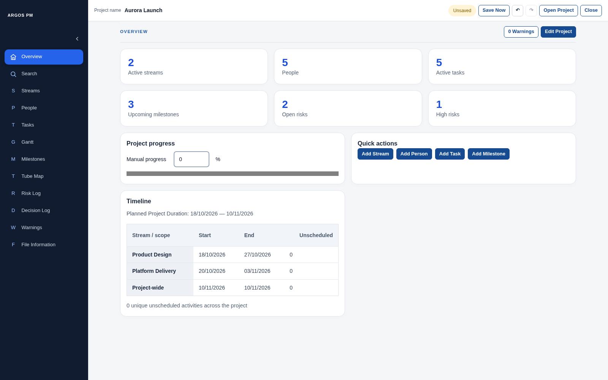
*Figure 1. Expanded navigation sidebar, application header and main content area. Open the image for its full-resolution view.*

| What you see | Recommended UI term | Meaning / behaviour |
| --- | --- | --- |
| ARGOS PM | Brand / home button | Returns to Overview. |
| Left navigation area | Navigation sidebar | Contains the 12 module navigation items. |
| Blue navigation item | Active navigation item | Identifies the current page; a hover highlight is different. |
| Chevron | Sidebar collapse / expand button | Switches between sidebar and compact navigation rail. |
| Project name + Aurora Launch | Field label + project name display | Identifies the open project; this header display is not a name-edit field. |
| Saved / Unsaved / Save failed | Save-status indicator | Persistent feedback about the project file. |
| Save Now | Global action button | Saves dirty project data; disabled when there is nothing to save. |
| Undo and Redo icons | Icon buttons | Operate on project edit history; may be disabled. |
| Open Project and Close | Global action buttons | Open a local project or return to the launcher. |
| Right-hand workspace | Main content area | Holds the current module page and may scroll. |

**Usage note:** Say “application header” rather than “top title bar”; “page header” rather than “second header”.

**Usage note:** The module views live inside the same web application. Sidebar items are navigation items, not tabs.

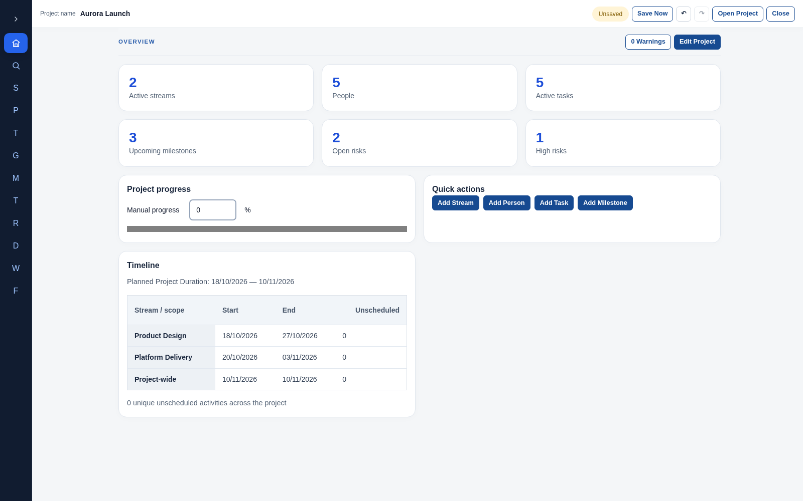
*Figure 2. Compact navigation rail after collapsing the sidebar.*

## Launcher

The entry screen before a project is active. The current v1.4.0 launcher heading says Project Manager; the workspace uses ARGOS PM branding.

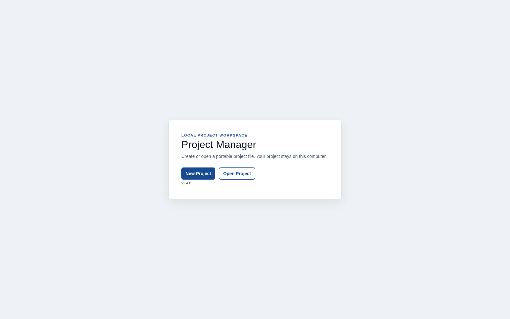
*Figure 3. Launcher with project commands and application version. Open the image for its full-resolution view.*

| What you see | Recommended UI term | Meaning / behaviour |
| --- | --- | --- |
| Project Manager | Screen heading | Names the entry screen in this build. |
| Local project workspace | Eyebrow / introductory label | Short context above the main heading. |
| Explanatory paragraph | Supporting text | Explains local project files. |
| New Project | Primary action button | Opens the project creation screen. |
| Open Project | Secondary action button | Invokes the file picker for an existing PMP file. |
| v1.4.0 | Version label | Identifies the runtime version. |

## New Project

A standalone creation screen, rather than a table-based inline creation form.

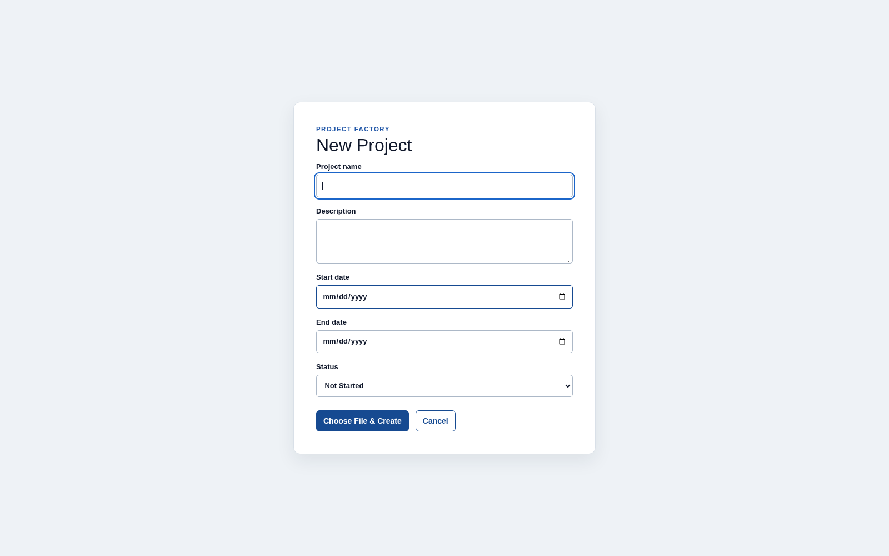
*Figure 4. Project creation form before a file is selected. Open the image for its full-resolution view.*

| What you see | Recommended UI term | Meaning / behaviour |
| --- | --- | --- |
| New Project | Page heading | Names the screen. |
| Project name | Required text field | The name used for the new project. |
| Description | Text area | Optional multi-line project description. |
| Start date and End date | Date fields / date pickers | Define the planned project date range. |
| Status | Select control | Choose one project lifecycle status. |
| Choose File & Create | Submit button | Validates the draft, requests a local file and creates the project. |
| Cancel | Secondary action button | Returns to the launcher without creating a project. |

**Usage note:** A validation message shown next to a field is a field validation message, not a notification or a tooltip.

**Usage note:** The native file picker is not a page of ARGOS PM and is not pictured here.

## Overview

The project summary page combines metrics, quick actions, progress and a timeline.

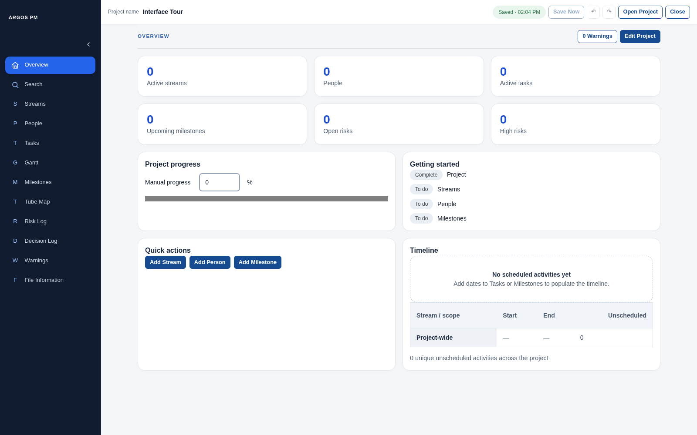
*Figure 5. New-project Overview with the Getting started checklist. Open the image for its full-resolution view.*

| What you see | Recommended UI term | Meaning / behaviour |
| --- | --- | --- |
| OVERVIEW | Page heading | Names the active page. |
| 0 Warnings / 1 Warning | Count-bearing navigation button | Opens the Warnings page. |
| Edit Project | Page action button | Opens Project Details as a modal dialog. |
| Active streams, People, Active tasks, Upcoming milestones, Open risks, High risks | KPI / summary cards | Display project counts and navigate to the related module. |
| Project progress | Section heading | Introduces progress controls. |
| Manual progress percentage | Number input | Edits the project percentage. |
| Horizontal completion indicator | Progress bar | Displays completion visually. |
| Getting started | Checklist section | Appears while the new project is incomplete; items show readiness states. |
| Quick actions | Action group | Provides shortcuts to record creation. |
| Timeline | Summary table section | Shows the planned range, scoped rows and unscheduled counts. |
| Project Details | Modal dialog | Contains project fields and the Show progress information checkbox. |

**Usage note:** Project Details uses a modal dialog with a backdrop and a close icon. Its Close/Done path commits valid edits; it is not a discard action.

**Usage note:** Do not call the KPI cards table cells. Do not confuse the percentage input with its progress bar.

*Figure 6. Populated Overview with summary cards and the timeline.*

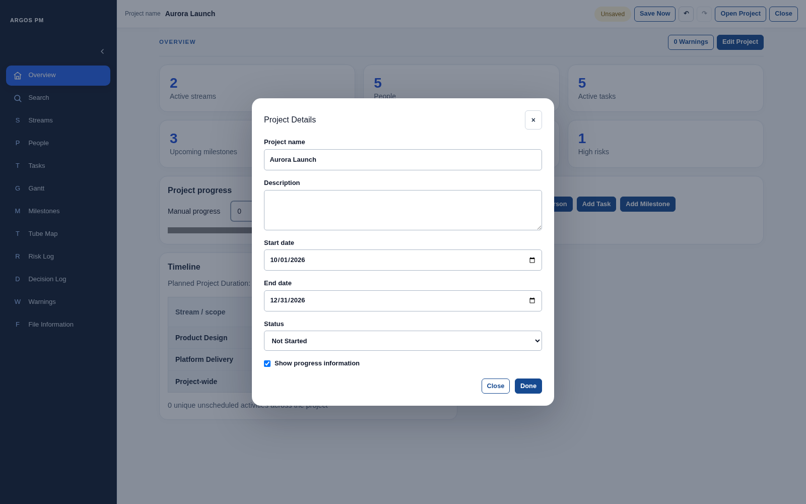
*Figure 7. Project Details modal opened with Edit Project.*

## Search

Project-wide search finds records by their name, title or visible ID.

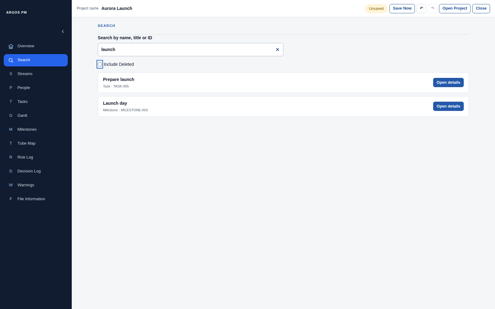
*Figure 8. Search results for launch. Open the image for its full-resolution view.*

| What you see | Recommended UI term | Meaning / behaviour |
| --- | --- | --- |
| SEARCH | Page heading | Names the module view. |
| Search by name, title or ID | Field label | Describes the project-wide search field. |
| For example TASK-001 | Placeholder text | An example, not a saved search value. |
| Search input | Search field | Filters results as text changes. |
| Include Deleted | Checkbox | Allows soft-deleted records to appear. |
| Result name with type and ID | Search result summary | Identifies the matching entity. |
| Open details | Navigation action button | Opens the relevant page and targets the record. |
| Deleted | Status badge | Marks a soft-deleted result. |
| Restore | Record action button | Restores a deleted result. |
| No results / Find anything in this project | Empty state | Explains an empty query or no matching records. |

**Usage note:** Search is cross-module. The Decision Log Filter field only filters decisions.

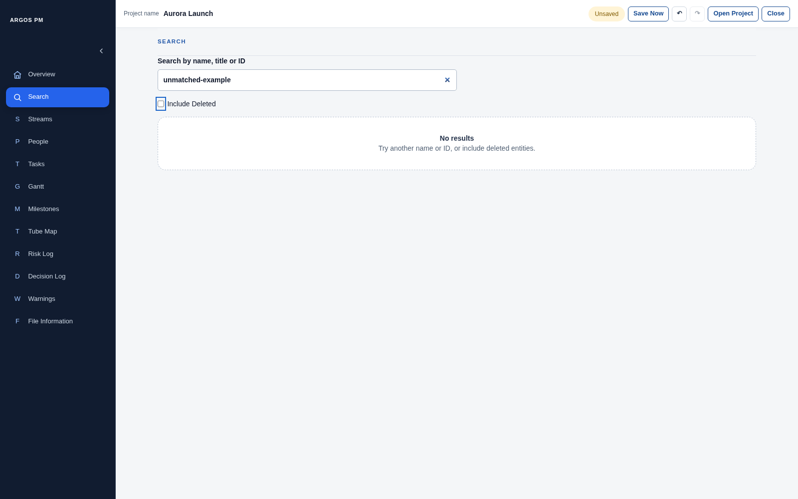
*Figure 9. No-results empty state.*

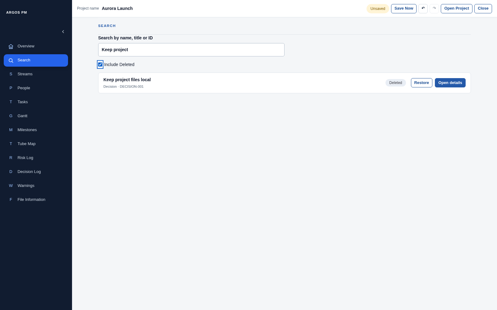
*Figure 10. Deleted result included explicitly, with Deleted badge and Restore action.*

## Streams

Streams organise project work into delivery groups. Most table fields support inline editing.

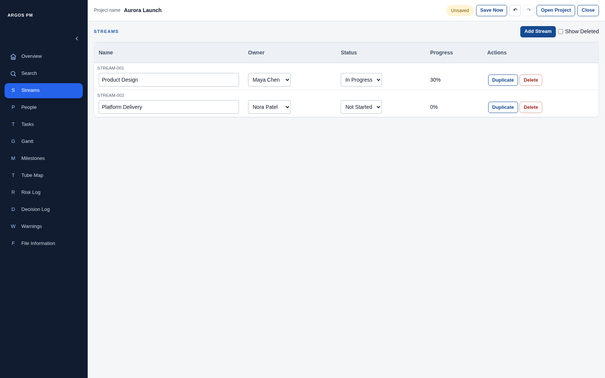
*Figure 11. Streams table with owners, lifecycle status and calculated progress. Open the image for its full-resolution view.*

| What you see | Recommended UI term | Meaning / behaviour |
| --- | --- | --- |
| STREAMS and Add Stream | Page heading and create action | The top button reveals the creation form. |
| Show Deleted | Checkbox filter | Includes soft-deleted Streams. |
| Name, Owner, Status, Progress | Column headers / sort controls | Identify the table columns; meaningful sortable headers change row order. |
| STREAM-001 | Record identifier | Identifies the Stream independently of its name. |
| Stream name | Inline text field | Edits the record name. |
| Owner | Select control | Assigns one active Person or Unassigned. |
| Status | Select control | Edits the Stream lifecycle status. |
| Progress percentage | Calculated value | Derived from tasks; not a manual percentage field in this table. |
| Duplicate / Delete / Restore | Row actions | Copy, soft-delete or restore the record. |
| Stream name + Add Stream + Cancel above table | Inline creation form | Its Add Stream button submits the draft; Cancel closes it. |

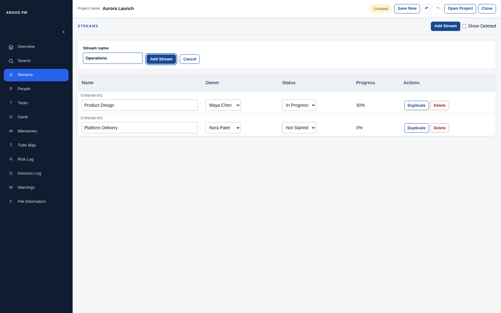
*Figure 12. Add Stream opens an inline creation form above the table.*

## People

People are project records used for ownership, not user accounts or login identities.

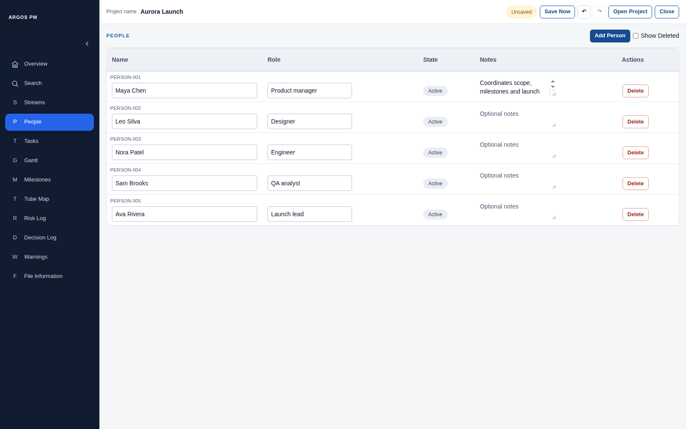
*Figure 13. People table with optional roles and notes. Open the image for its full-resolution view.*

| What you see | Recommended UI term | Meaning / behaviour |
| --- | --- | --- |
| PEOPLE and Add Person | Page heading and create action | Opens an inline creation form. |
| Show Deleted | Checkbox filter | Includes deleted Person records. |
| Name, Role, State, Notes, Actions | Table column headers | State describes Active/Deleted record state, not project lifecycle status. |
| PERSON-001 | Record identifier | A stable human-readable Person ID. |
| Name and Role | Inline text fields | Edit the Person name and optional role. |
| Optional role | Placeholder text | Visible when Role is empty. |
| Notes | Text area | Multi-line inline notes. |
| Active / Deleted | Status badge | Shows record state; it is not a dropdown. |
| Delete / Restore | Row actions | Change the record deletion state. |
| Person name, Add Person, Cancel | Inline creation form controls | The form submit action creates the Person. |

**Usage note:** Name, Role and Notes commit on leaving the field. There is no per-row Save button here.

**Usage note:** Use “Person record” rather than “account” when discussing this module.

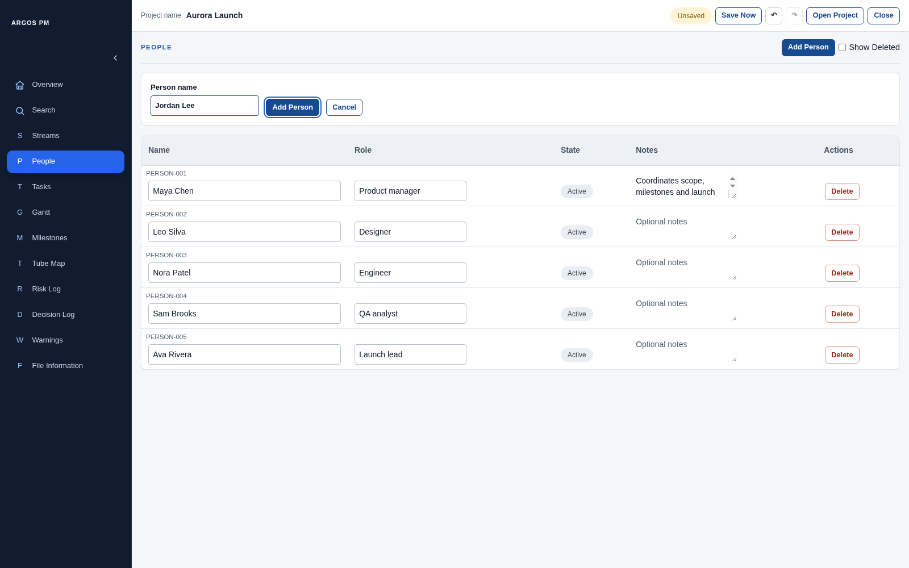
*Figure 14. Person creation form.*

## Tasks

Tasks combine editable work records, single scope, ownership, dates and predecessor relationships.

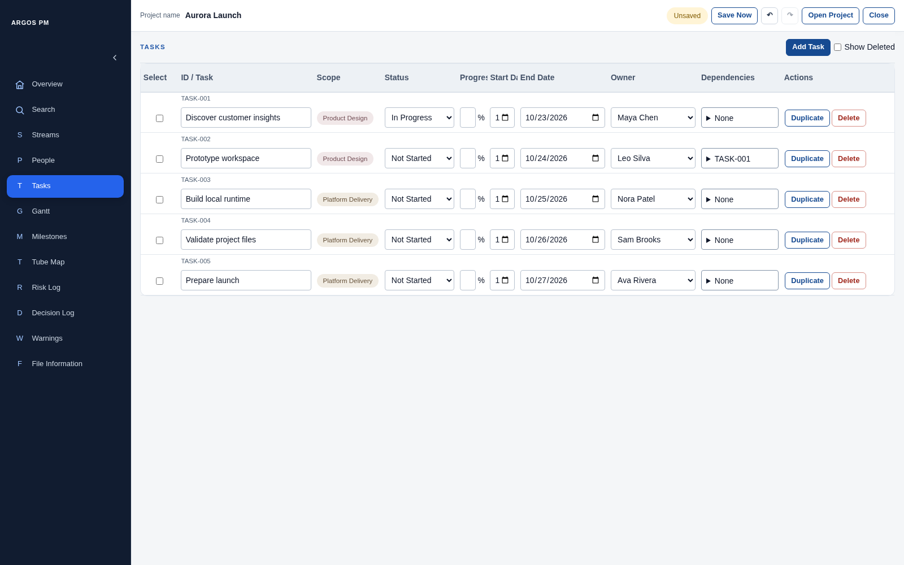
*Figure 15. Tasks table with scope pills, progress and ownership. Open the image for its full-resolution view.*

| What you see | Recommended UI term | Meaning / behaviour |
| --- | --- | --- |
| TASKS, Add Task, Show Deleted | Page header controls | Create a record or include deleted ones. |
| Select checkbox per row | Row selection checkbox | Selects Tasks for a bulk action; it does not set completion. |
| ID / Task | Combined identifier/name column | Contains a record ID and inline task-name field. |
| Scope pill | Scope display | Shows Project-wide or the assigned Stream; the row pill is not an editable dropdown. |
| Status | Select control | Sets the Task lifecycle status. |
| Progress | Number input with unit suffix | Edits a percentage when the Task permits manual progress. |
| Start Date and End Date | Date fields | Edit the Task date range; invalid ranges show a validation message. |
| Owner | Select control and sortable column | Assigns one Person; sort resolves displayed Person names and keeps unassigned values last. |
| Dependencies / None / TASK-001 | Predecessor selector | An expandable checkbox list for Finish-to-Start relationships. |
| Duplicate / Delete / Restore | Row actions | Operate on one Task. |
| Delete selected (n) | Bulk action button | Appears when rows are selected; applies to those Tasks. |
| Task name, Scope, Owner and Predecessor Tasks (optional) | Creation form controls | Scope and Owner are single-selects; predecessors use multiple checkbox selections. |

**Usage note:** A predecessor selector is not an action menu. It contains record choices, not commands.

**Usage note:** Task name commits on blur/Enter. Dates, selects and percentages update through their controls. Inline table edits do not have a Cancel button; use project Undo where appropriate.

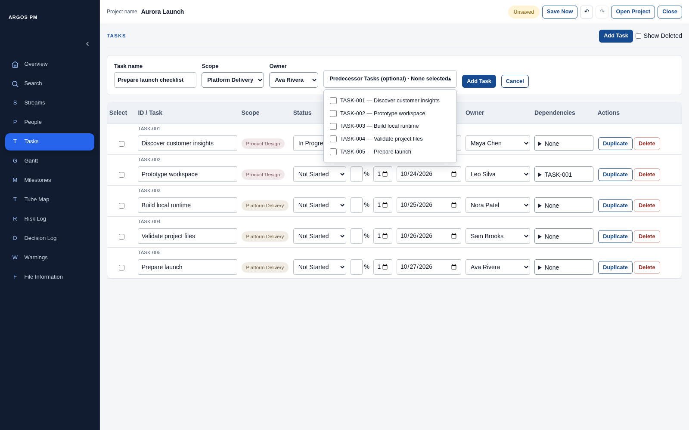
*Figure 16. Task creation form with its optional predecessor selector expanded.*

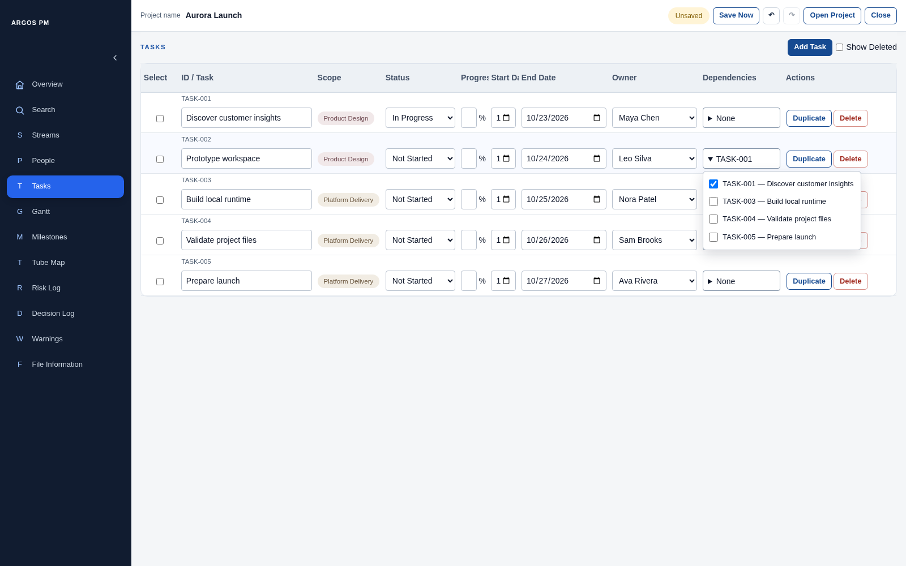
*Figure 17. Existing Task predecessor selector expanded.*

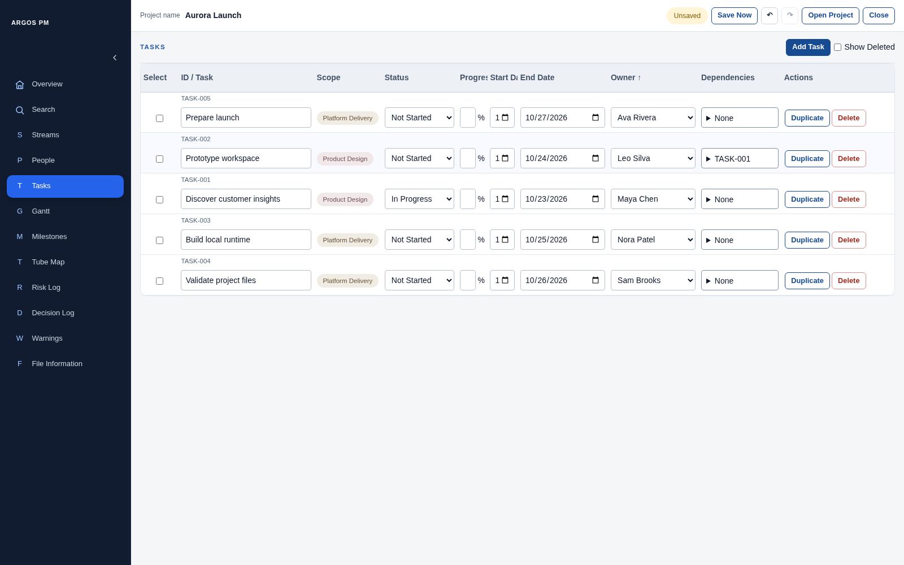
*Figure 18. Owner column sorted in ascending order.*

## Gantt

A timeline view of work grouped by scope. Use view for the visual presentation, lane/group for its horizontal structure, and bar/marker for work items.

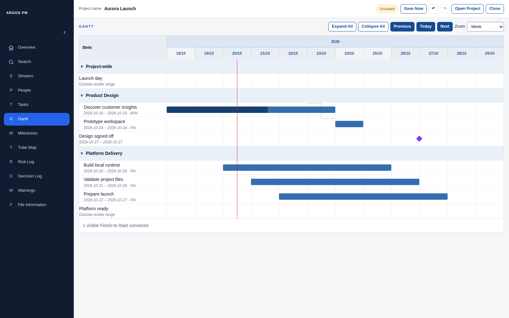
*Figure 19. Gantt lanes, task bars, milestone markers, connector and Today line. Open the image for its full-resolution view.*

| What you see | Recommended UI term | Meaning / behaviour |
| --- | --- | --- |
| GANTT | Page heading | Names the visual view. |
| Expand All / Collapse All | Group expansion controls | Show or hide items in all groups. |
| Triangle beside a group | Disclosure button | Expands or collapses one group. |
| Stream group label | Navigation button | Opens that Stream in Streams; Project-wide is a scope group. |
| Previous / Today / Next | Timeline navigation buttons | Change or reset the visible date window. |
| Zoom | Select control | Chooses Week, Month or Quarter time granularity. |
| Year and date labels | Timeline / date axis | Explain the visible time scale. |
| Blue horizontal shape | Task bar | Represents a scheduled Task duration; internal fill can show progress. |
| Milestone point | Milestone marker | Shows a checkpoint date when within the visible range. |
| Vertical date line | Today line | Marks the current date. |
| Item header | Stream sort control | Sorts the Stream groups, rather than moving records between scopes. |
| Unscheduled / Outside visible range | Schedule annotation | Distinguishes missing dates from items outside the current window. |
| Arrow between task bars | Dependency connector | Displays a Finish-to-Start relationship. |
| Quick edit task | Anchored popover | Contains Name, Start date, End date and Save / Open Task / Cancel. |

**Usage note:** Save applies the quick-edit draft; Cancel closes the popover without applying that draft. Open Task navigates to the underlying record.

**Usage note:** This floating editor is a popover, not a modal dialog: there is no dimmed full-page backdrop.

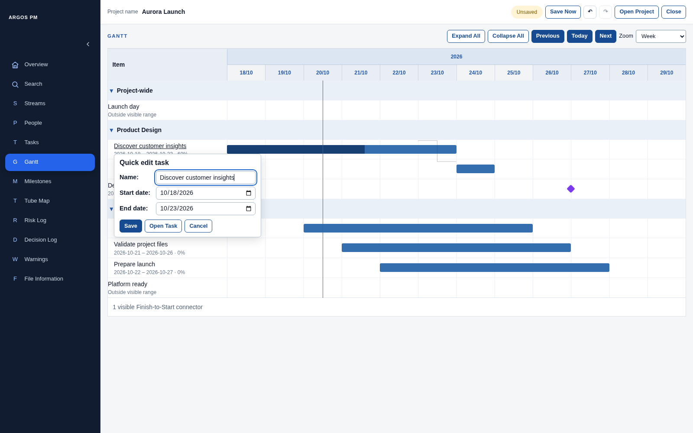
*Figure 20. Quick edit task popover anchored to the clicked item.*

## Milestones

Milestones are dated checkpoints with scope, ownership and predecessor relationships.

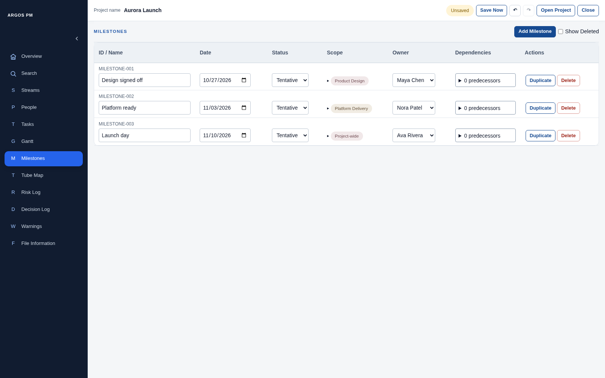
*Figure 21. Milestones table with stream and Project-wide scope pills. Open the image for its full-resolution view.*

| What you see | Recommended UI term | Meaning / behaviour |
| --- | --- | --- |
| MILESTONES, Add Milestone, Show Deleted | Page header controls | Create or include deleted records. |
| ID / Name | Identifier and inline text field | Names the checkpoint and displays its ID. |
| Date | Date field / date picker | Sets the planned milestone date. |
| Status | Select control | Sets the milestone lifecycle status. |
| Scope | Expandable scope selector | Its summary displays scope pills. |
| Project-wide inside scope choices | Radio option | Selects the exclusive whole-project scope. |
| Stream choices inside scope | Checkbox group | Select one or more Streams. |
| Owner | Select control | Assigns one Person. |
| Dependencies / n predecessors | Predecessor selector | Can select active Tasks and other Milestones as predecessors. |
| Dependency warning indicator, when present | Warning disclosure | Reveals scheduling or predecessor issues for that milestone. |
| Duplicate / Delete / Restore | Row actions | Operate on the selected record. |
| Name, Date, Predecessors (optional), Add Milestone, Cancel | Inline creation form | Creates a checkpoint; scope and owner can then be edited in the row. |

**Usage note:** Say “scope selector” for the whole interactive control and “scope pill” for the rounded displayed value.

**Usage note:** Do not assume all dependency issues appear in the Warnings page: Milestone predecessor issues are also shown locally in Milestones/Gantt.

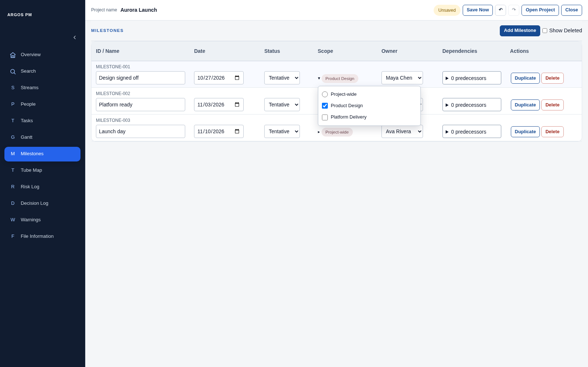
*Figure 22. Expanded scope selector combines an exclusive Project-wide option and stream checkboxes.*

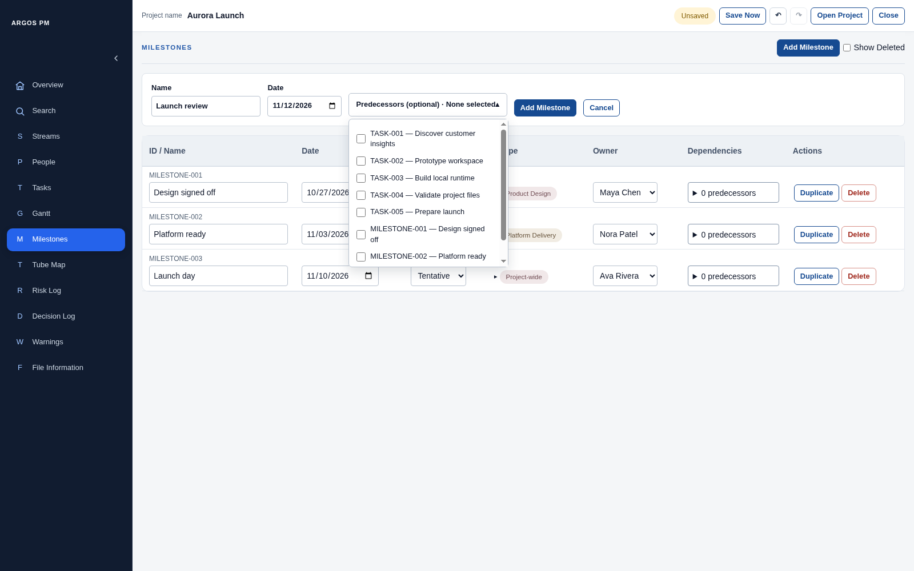
*Figure 23. Milestone creation form with predecessor choices.*

## Tube Map

A roadmap-style view of Milestones on scope lanes, rather than a Task table.

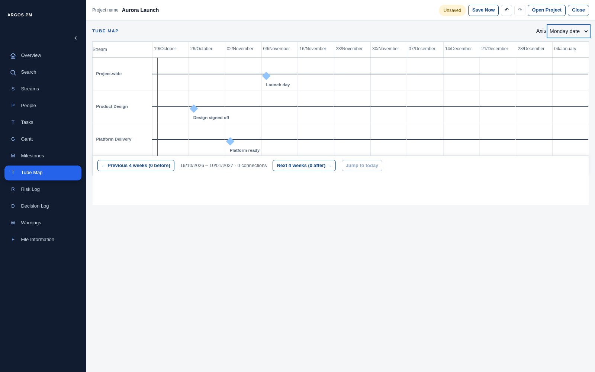
*Figure 24. Tube Map using the Monday date axis. Open the image for its full-resolution view.*

| What you see | Recommended UI term | Meaning / behaviour |
| --- | --- | --- |
| TUBE MAP | Page heading | Names the view. |
| Axis | Select control | Switches Week Number / Monday date labels. |
| Stream heading | Lane sort control | Changes Stream lane ordering. |
| Stream column and time labels | Lane heading and date axis | Identify scope lanes and the visible weeks. |
| Horizontal line | Roadmap lane | Represents a Stream or the Project-wide scope. |
| Diamond | Milestone marker / station | A clickable checkpoint; its text label can also open quick edit. |
| Line joining milestone points | Milestone connection | Displays a relationship when available. |
| Vertical line | Today line | Marks the current date window position. |
| Previous 4 weeks / Next 4 weeks / Jump to today | View navigation controls | Page the roadmap or reset its window; boundary counts show items outside it. |
| Date range and connection count | View summary | Describes the window and visible relationships. |
| Quick edit milestone | Anchored popover | Contains Name, Date and Save / Open Milestone / Cancel. |

**Usage note:** The bottom navigation area belongs to the Tube Map view; call it the view navigation footer.

**Usage note:** A Milestone station is not a Task bar. A lane is not a data-table row, even though both run horizontally.

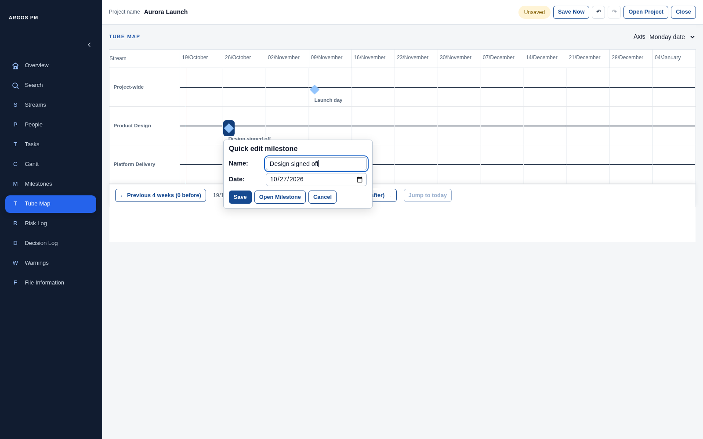
*Figure 25. Milestone quick-edit popover opened from a diamond.*

## Risk Log

The page combines a matrix, a filter and an editable record table. Risk actions are separate mitigation items nested under a Risk.

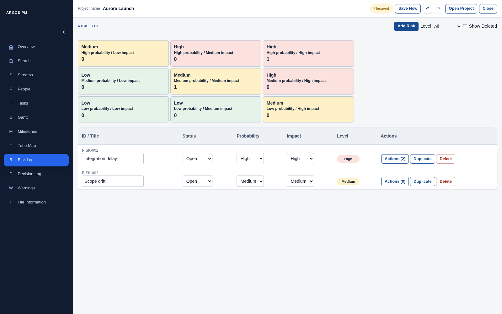
*Figure 26. Risk matrix and editable Risk table. Open the image for its full-resolution view.*

| What you see | Recommended UI term | Meaning / behaviour |
| --- | --- | --- |
| RISK LOG, Add Risk, Level, Show Deleted | Page header and filter controls | The top Add Risk button reveals the creation form. |
| Nine coloured boxes | Risk matrix | A 3 by 3 probability-by-impact grid. |
| One matrix cell | Interactive matrix cell | Displays probability, impact, calculated severity and a matching-record count. |
| Level | Severity filter / select control | Shows All, Low, Medium or High records. |
| ID / Title | Record ID and inline text field | Identifies and names the Risk. |
| Status, Probability and Impact | Select controls | Edit one value in each category. |
| Low / Medium / High in Level column | Risk-level badge | A calculated severity display, not a dropdown. |
| Actions (n) | Row expander button with count | Opens or closes Risk actions. It is not a dropdown menu. |
| Duplicate / Delete / Restore | Record row actions | Operate on the parent Risk record. |
| Risk actions | Expandable row details panel | Contains mitigation items and their creation form. |
| Action 1 / Action 2 description fields | Inline text fields | Edit mitigation descriptions; each has a Delete button. |
| New action description, Add action, Cancel | Nested creation form | Add action submits a mitigation item; disabled while the description is blank. |
| Action deleted. Undo | Inline status message and recovery action | Restores the just-removed mitigation item. |

**Usage note:** Clicking a matrix cell currently sets the Level filter to that severity; it does not filter to only that exact probability/impact combination.

**Usage note:** Cancel in the nested new-action form clears its draft description; it does not close the whole Risk actions panel.

**Usage note:** A Risk action is a domain record (mitigation item). A row action is a UI command such as Duplicate or Delete. Prefix the word action to avoid ambiguity.

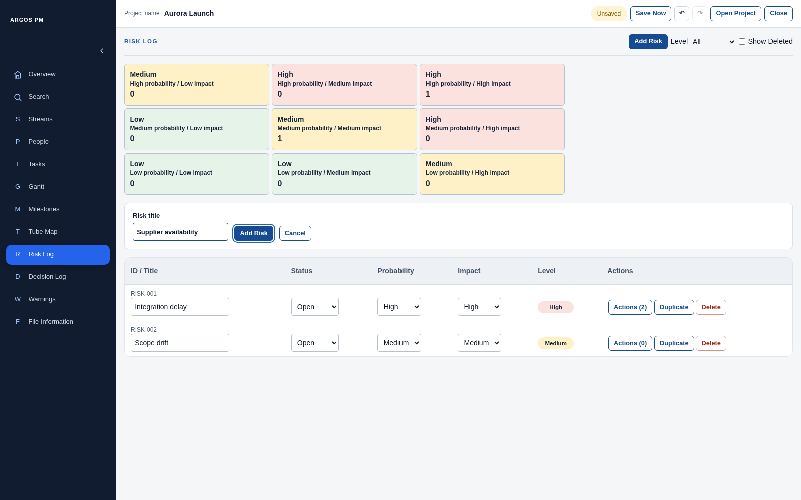
*Figure 27. Risk creation form.*

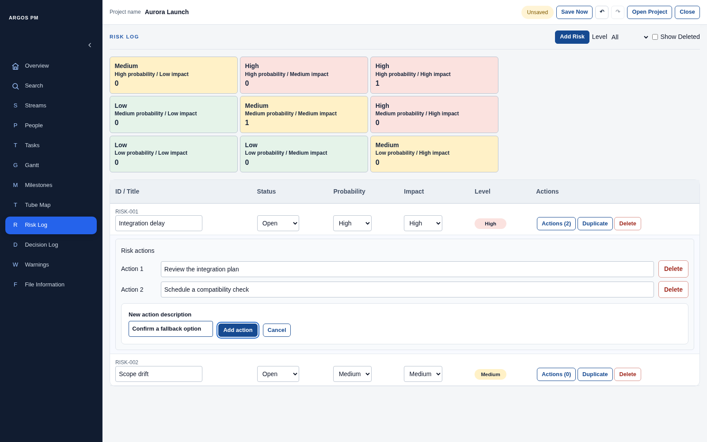
*Figure 28. Risk actions expanded beneath the parent Risk row.*

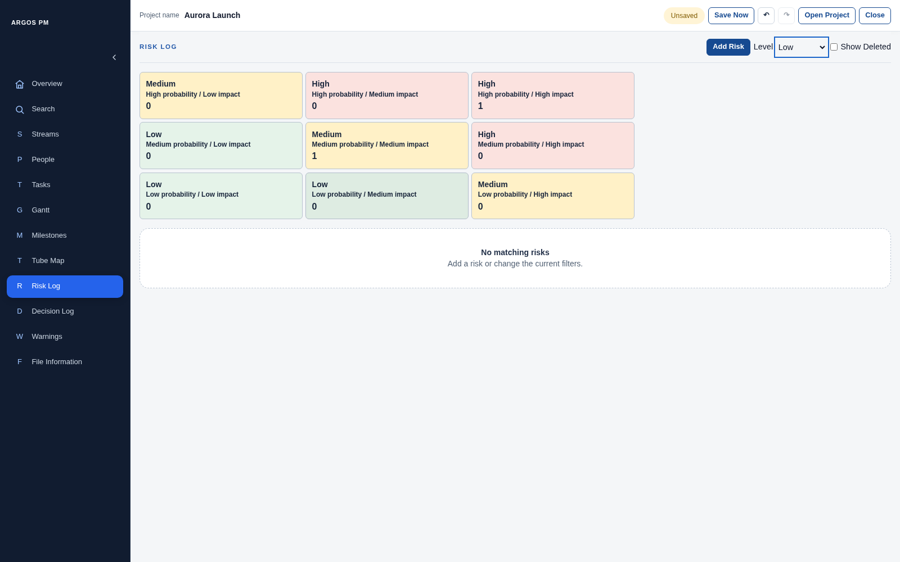
*Figure 29. A Level filter with no matching records.*

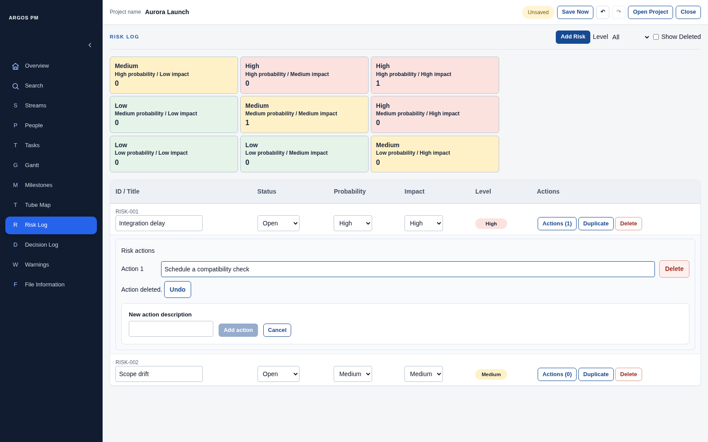
*Figure 30. Inline deletion feedback with Undo for a removed mitigation action.*

## Decision Log

Decisions support an editable title/date/owner row and a larger inline editor for their context.

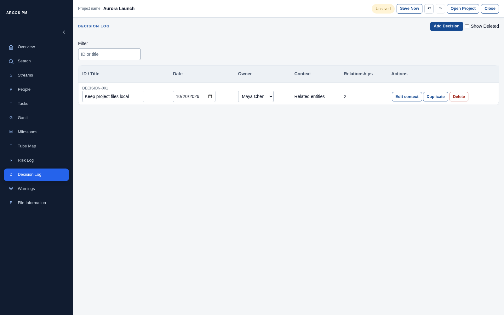
*Figure 31. Decision Log table and text filter. Open the image for its full-resolution view.*

| What you see | Recommended UI term | Meaning / behaviour |
| --- | --- | --- |
| DECISION LOG, Add Decision, Show Deleted | Page header controls | Create or include deleted records. |
| Filter with ID or title | Text filter and placeholder | Narrows the Decision table only. |
| ID / Title, Date, Owner | Editable record columns | Use a text field, date field and single-select Owner. |
| Context | Read-only context summary | Shows Project-wide, Related entities or Unassigned. |
| Relationships | Relationship count / summary | Counts linked Streams and Milestones, or displays Project-wide; it is not a link button. |
| Edit context | Row action button | Opens an inline edit panel underneath the row. |
| Decision context | Inline edit panel / section heading | Groups the relationship choices. |
| Project-wide (exclusive) | Checkbox with exclusive behaviour | Clears Stream and Milestone choices when selected; visually a checkbox, not a radio button. |
| Streams and Milestones | Checkbox groups | Select several related records when not Project-wide. |
| Additional information | Text area | Edits notes/background for the Decision. |
| Save / Cancel within context editor | Commit / discard draft buttons | Apply or discard the context draft. |
| Duplicate / Delete / Restore | Row actions | Copy, soft-delete or restore a Decision. |

**Usage note:** The Decision context panel is not a modal dialog or a drawer; it is embedded in the table.

**Usage note:** Context choices are saved with the panel Save button. Direct edits to Title, Date and Owner are inline edits.

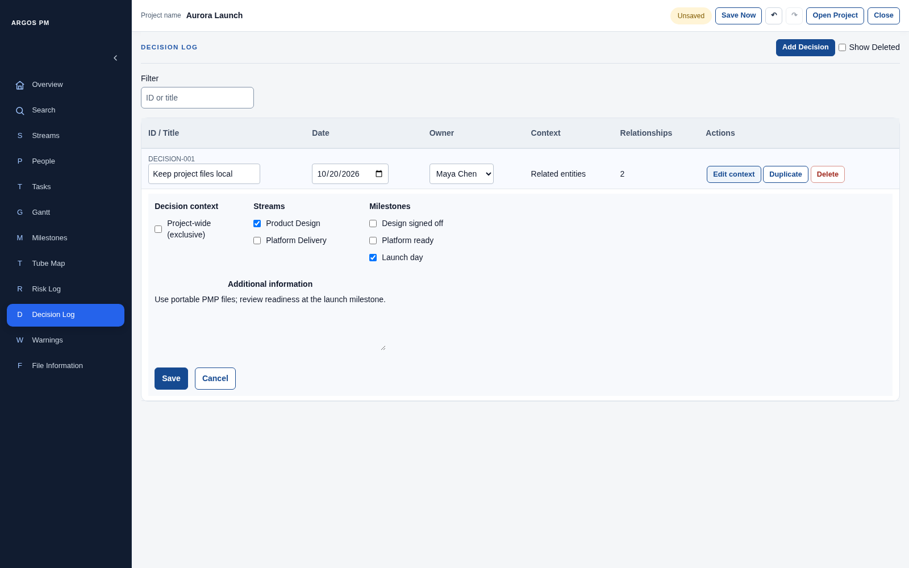
*Figure 32. Inline Decision context editor with checkbox groups.*

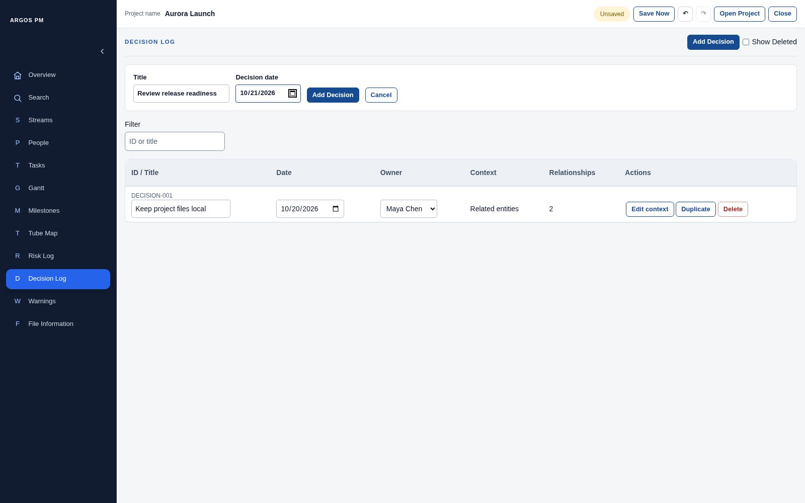
*Figure 33. Decision creation form.*

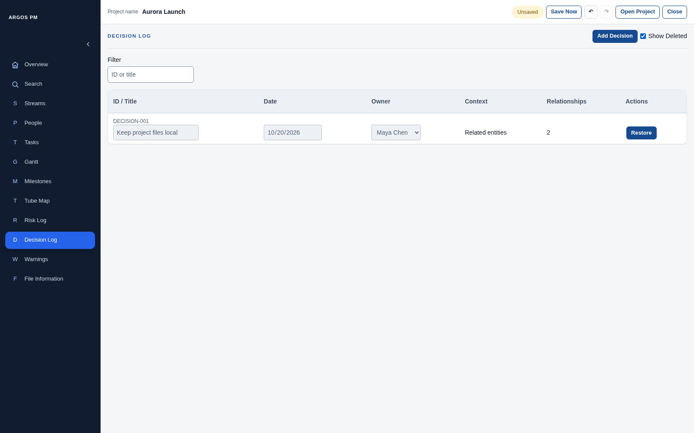
*Figure 34. A soft-deleted record with Restore available.*

## Warnings

Warnings are derived from current project data. Correcting the underlying inconsistency removes the warning.

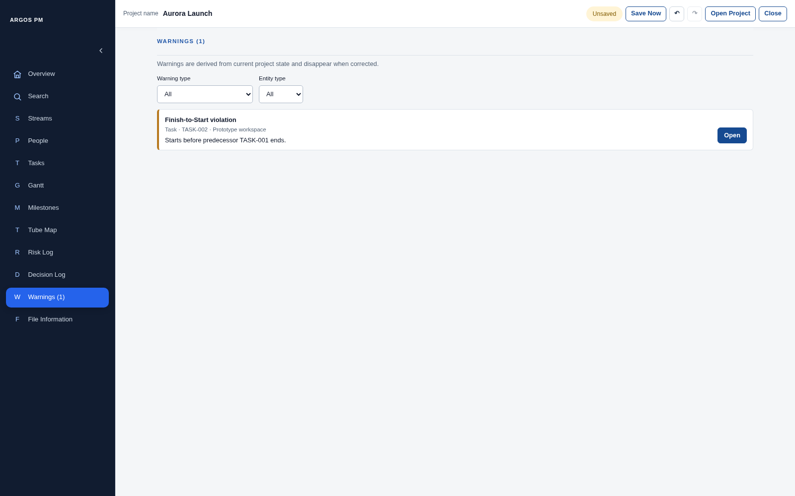
*Figure 35. A genuine Finish-to-Start scheduling warning. Open the image for its full-resolution view.*

| What you see | Recommended UI term | Meaning / behaviour |
| --- | --- | --- |
| WARNINGS (n) | Page heading with count | Shows the total active warning count. |
| Warnings (n) in navigation | Navigation count indicator | Surfaces the same project consistency count. |
| Warning type and Entity type | Filter selects | Narrow the warning list. |
| Finish-to-Start violation | Warning heading / type | Classifies the scheduling issue. |
| Task, TASK-002 and record name | Affected-record summary | Identifies the item requiring attention. |
| Explanatory sentence | Warning description | Explains the inconsistency. |
| Open | Navigation action button | Opens the appropriate module and targets the record. |
| Highlighted row | Navigation target highlight | Marks the record reached from the warning. |
| No project warnings / No matching warnings | Empty state | Distinguishes a clean project from a filter that matches nothing. |
| Remove dependency / Remove from milestone scope, when applicable | Corrective action button | Available for certain deleted-reference issues; not every warning has one. |

**Usage note:** The example keeps TASK-001 as predecessor and corrects TASK-002 to start after TASK-001 finishes. The count then returns to zero.

**Usage note:** Do not call the navigation count a toast, or assume every warning is an error that blocks saving.

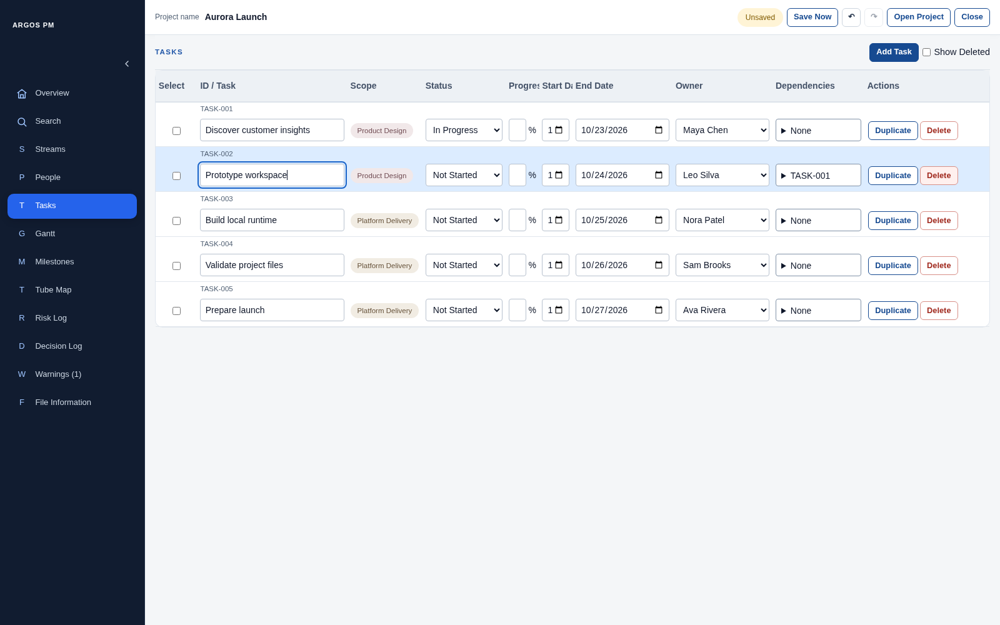
*Figure 36. Open navigates to and highlights the affected Task row.*

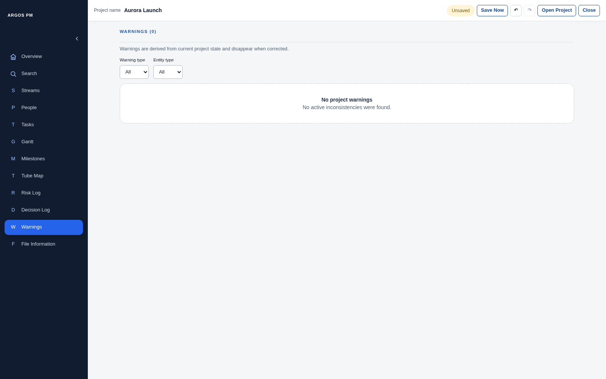
*Figure 37. The empty state after the conflicting date is corrected.*

## File Information

This page describes the current local project file and the optional audit history stored inside it.

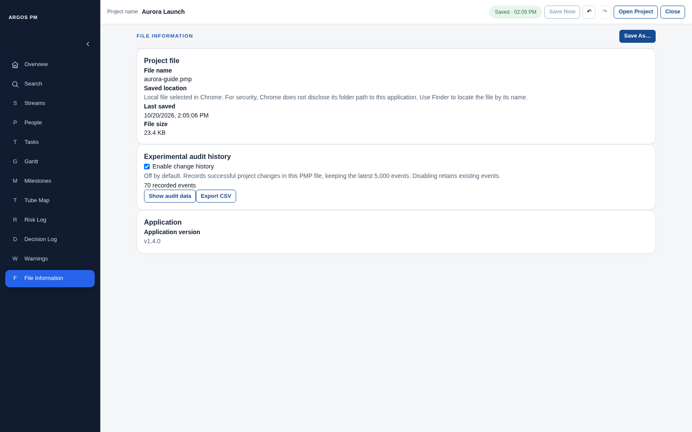
*Figure 38. Project file metadata, audit controls and application version. Open the image for its full-resolution view.*

| What you see | Recommended UI term | Meaning / behaviour |
| --- | --- | --- |
| FILE INFORMATION and Save As... | Page heading and file action | Save As requests another file through the browser picker. |
| Project file | Metadata card / section | Groups file name, saved location explanation, last saved time and size. |
| Experimental audit history | Optional feature section | Contains tracking and viewer controls. |
| Enable change history | Checkbox | Enables future recording of successful changes; off by default. |
| n recorded events | Count indicator | Number of retained events, not the number currently visible. |
| Show audit data / Hide audit data | Disclosure button | Opens or closes the viewer. |
| Export CSV | Export action button | Exports the full retained audit history, independent of the text filter. |
| Filter audit history | Text filter | Narrows displayed matching events. |
| Newest first / Oldest first | Sort-direction button | Changes chronological order. |
| Time, Change, Entity, Field, Before, After | Audit table column headers | Describe each recorded change. |
| Showing n of m matching events | Display-count summary | The viewer shows up to 50 matching events; the file retains up to 5,000. |
| Application / Application version | Metadata section and version value | Identifies the runtime version. |

**Usage note:** The app does not disclose the full filesystem folder path. The Saved location text explains that browser boundary.

**Usage note:** Audit history is not the Undo/Redo stack. CSV export is not a PMP project save.

**Usage note:** Audit event Entity values can contain internal UUIDs as well as human-readable IDs; use the human-readable ID when reporting a UI issue.

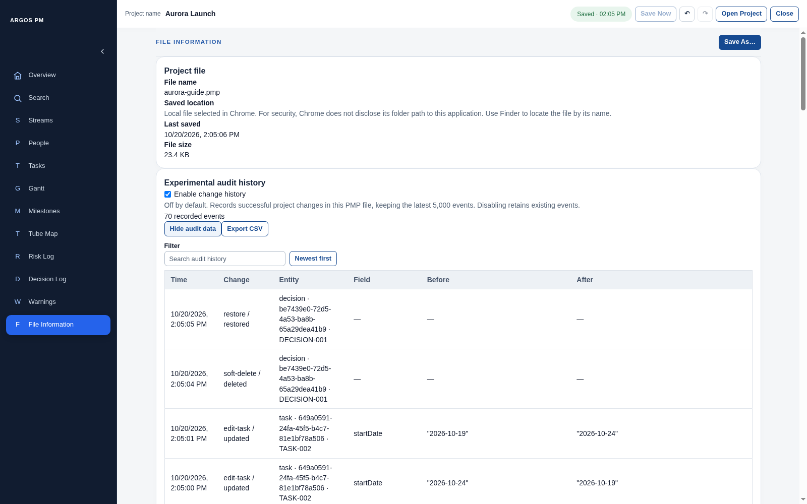
*Figure 39. Audit history expanded at its top.*

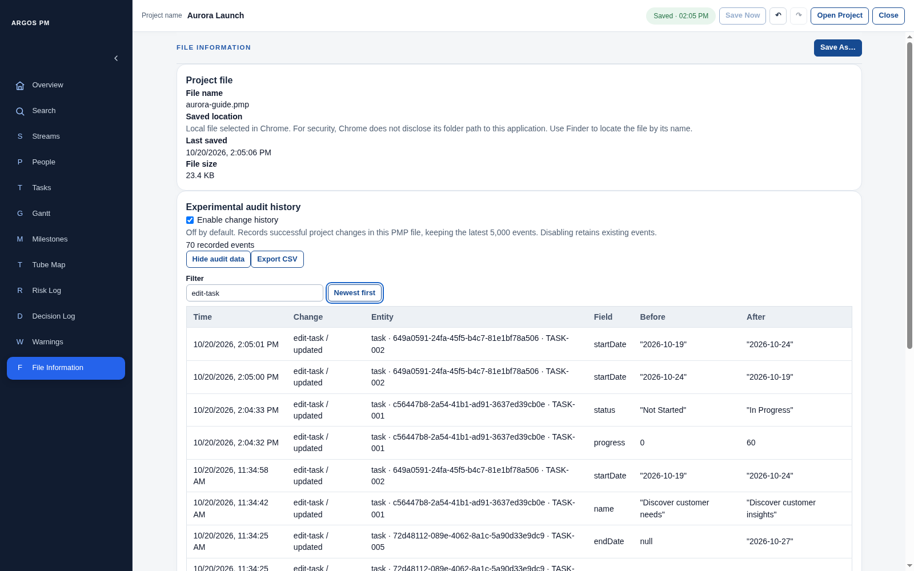
*Figure 40. Audit viewer narrowed with the text filter.*

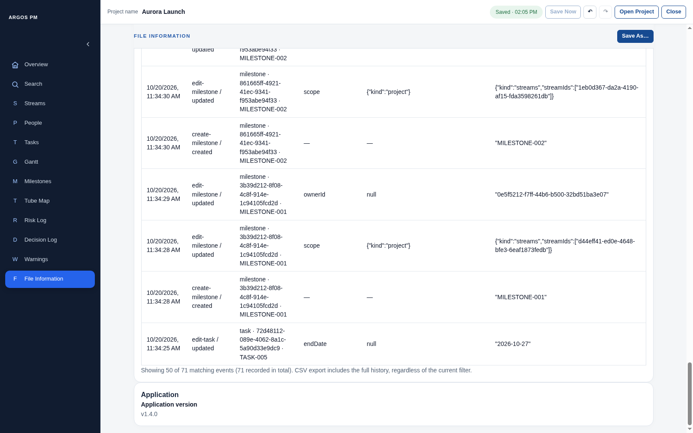
*Figure 41. The audit display-count summary and application version at the bottom of the page.*

## Shared dialogs, alerts and feedback

Use the visual behaviour to name the component, rather than calling every message a popup.

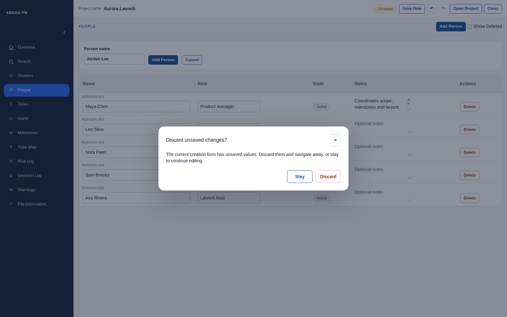
*Figure 42. Modal confirmation shown when navigating away from a filled creation draft. Open the image for its full-resolution view.*

| What you see | Recommended UI term | Meaning / behaviour |
| --- | --- | --- |
| Discard unsaved changes? | Confirmation dialog | Blocks navigation until the user chooses what to do. |
| Stay | Secondary dialog action | Preserves the draft and remains on the page. |
| Discard | Destructive dialog action | Discards that creation draft and navigates to the requested page. |
| Dimmed background | Dialog backdrop | Distinguishes this modal from a small anchored popover. |
| Close icon | Dialog close button | Accessible name identifies the dialog it closes. |
| Save failed | Inline alert | Appears within the workspace, with recovery text. |
| Retry | Recovery action button | Attempts the project save again. |
| Save As, when shown after repeated failures | Recovery action button | Offers another file when the runtime exposes it. |
| Save failed in global header | Save-status indicator | Persistent state, distinct from the explanatory alert below it. |

**Usage note:** The save-failure screenshot is an intentional test of the isolated fictional project. No user file was lost or overwritten.

**Usage note:** The guide does not force every browser/OS dialog or recovery condition. Uncaptured conditions such as external-file conflicts are not presented as photographed pages.

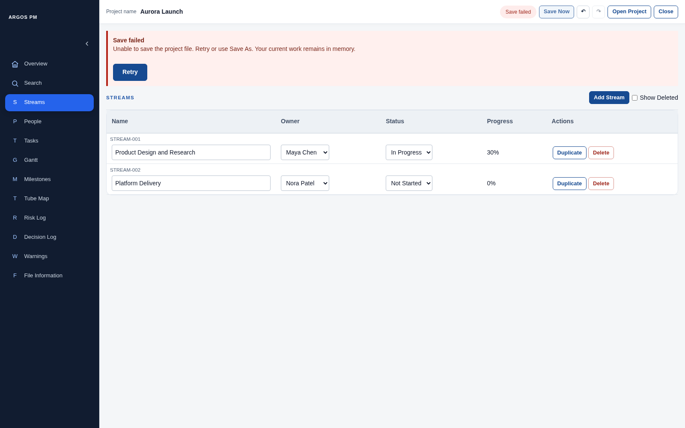
*Figure 43. Real application save-failure alert generated through a controlled disposable file-handle failure.*

## Writing requests and reporting issues

| Intention | Example request |
| --- | --- |
| Position a control | On the Risk Log page, move the Level filter into the page header beside Add Risk. |
| Change a field | In the People table, increase the height of the Notes text area for each record. |
| Change sorting | Make the Owner column header on the Tasks page sortable, with unassigned values last. |
| Describe expansion | On RISK-001, clicking the Actions expander should reveal the row details panel. |
| Describe a visual plan | In the Gantt view, keep the Today line visible when horizontal scrolling is used. |
| Describe an overlay | Anchor the Quick edit milestone popover to the clicked Tube Map diamond. |
| Describe a modal | In the Project Details dialog, place the close button in the dialog header. |
| Report a data issue | On the Warnings page, Open for TASK-002 should target the correct Task row. |
| Describe scope | In the Milestone scope selector, keep Project-wide exclusive and allow multiple Stream checkboxes. |
| Describe feedback | After Retry succeeds, clear the save-failure alert and update the save-status indicator. |

For a bug report, also include the record ID, current value, steps to reproduce and expected result. A screenshot of the relevant state helps distinguish a hover state, selection, focus or expanded panel.

## Keyboard and interaction reference

| Shortcut / action | Behaviour |
| --- | --- |
| Ctrl/Cmd + S | Save the active project. |
| Ctrl/Cmd + K | Open Search. |
| Ctrl/Cmd + Z | Undo a project command when focus is outside a text editor; text fields can use native text undo. |
| Ctrl/Cmd + Shift + Z or Ctrl/Cmd + Y | Redo a project command when the app handles the shortcut. |
| Tab / Shift + Tab | Move keyboard focus; modal dialogs keep focus within the dialog. |
| Escape | Close supported dialogs or expanded selectors; closing Project Details follows its normal save-on-close behaviour. |

## Capture scope and limitations

- Captured against source commit 3d6318eddaa174c3284abb55c33f2cf6c8e1f194. Screenshots use a 1600 × 1000 desktop Chromium viewport and actual application controls; no interface screens were fabricated.
- All project names, people, tasks and notes are fictional, in disposable projects. No private user project was opened or overwritten.
- Native browser/OS file pickers are outside the application pages and are not pictured. The managed browser blocks filesystem pickers, so a separate in-memory picker test boundary supplied the fictional project; application forms, navigation, serialization and save/retry UI ran normally.
- The save-failure alert was exercised deliberately by making the disposable test file handle reject a write and then allowing Retry. It is not an incident involving a user file.
- The source files and captured DOM inventories were reviewed alongside the images. This is a terminology reference for visible v1.4.0 UI, not a promise that every possible error or browser-native dialog was photographed. Screenshot values and counts vary as the fictional walkthrough proceeds.
- Terms such as badge/chip and page/view overlap across design systems. This guide recommends one consistent vocabulary for ARGOS PM and calls out synonyms or misleading alternatives.
