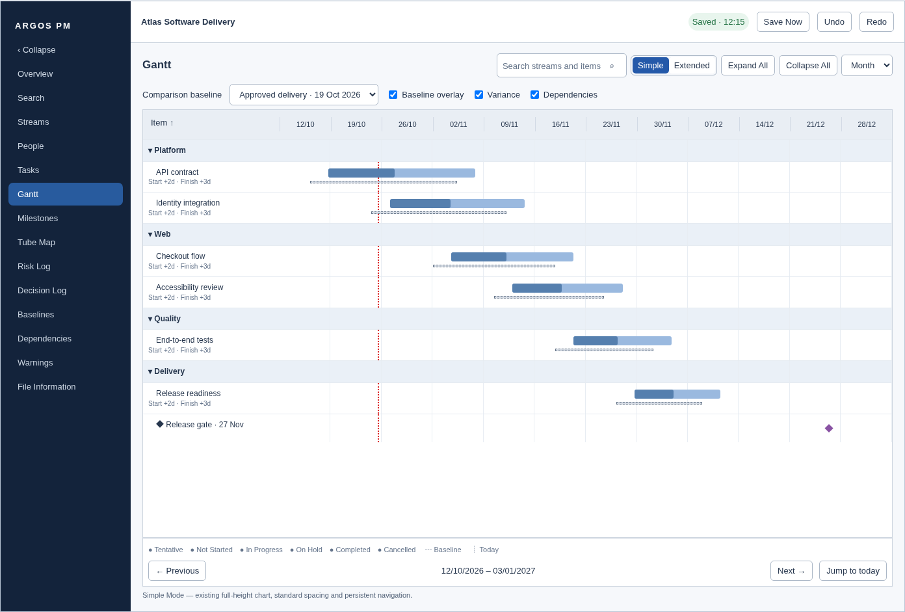
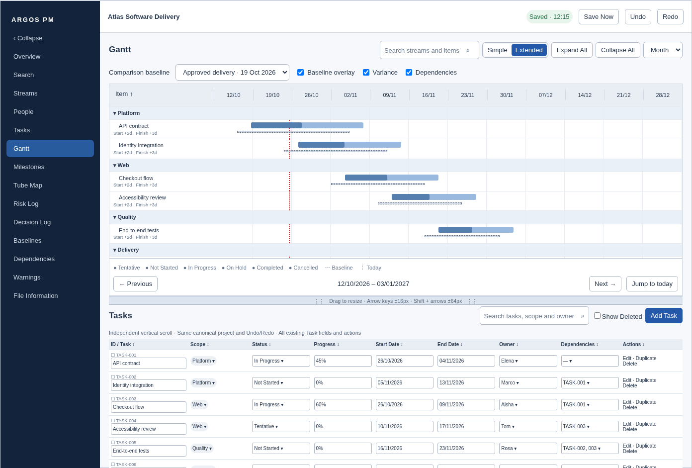

# Gantt Extended Mode — approval required

This is the Phase 6 design proposal, not an implemented feature. The owner must explicitly approve this mockup before Extended Mode code is added. The application currently contains Simple Gantt only.

The complete [presentation mockup](media/v16-mockup/extended-mode-mockup.html) includes populated project data and design notes. Open it locally in a browser to inspect at full size. Screenshots are mockup evidence, not application acceptance evidence.

## Proposed behavior

- The compact Simple / Extended switch is immediately before Expand All. Switching changes the layout only; it does not edit project data or clear either pane's filters.
- Simple retains the full-height existing chart, standard spacing and persistent date navigation. Baseline/dependency controls remain available.
- Extended shows the same Gantt above the same Tasks workspace. Initial split is approximately 55/45 of the available content height, after the shared project header and Gantt toolbar. Compact row spacing applies only within Extended Mode.
- The horizontal separator is draggable and keyboard focusable. Up/Down changes the split by 16px, Shift+Up/Down by 64px. Both panes have a minimum height of 200px. If the window cannot accommodate both, permit page vertical scrolling rather than clipping controls.
- Each pane scrolls vertically independently; the chart date axis, chart date footer and Tasks heading controls remain visible within their pane. No horizontal scrolling. At narrow desktop widths, Task fields wrap into labelled groups, with every existing field/action preserved.
- Gantt preserves quick edits, stream navigation, collapse/expand, sorting, zoom, Today marker, filters and dependency interactions. The bottom pane preserves Tasks hierarchy, names, scope, status, progress, dates, owners, dependencies, selection, bulk actions, duplication, creation, deletion and restoration.
- Baseline selection is shared across views. Overlay, variance and dependency visibility are view controls. The screenshot shows representative baseline controls and variance values; no trend analysis or automatic scheduling is included.
- Both panes subscribe to the same canonical project store. Editing either pane updates the other. Existing Undo/Redo and audit semantics are preserved.
- Standalone Tasks remains unchanged by Extended Mode styling. Simple Gantt remains unchanged by Extended Mode styling. REQ-001 viewport fitting and the approved baseline/dependency additions apply independently.

## Approval question

Approve this split layout, toggle placement, compact treatment, scrolling/resizing interactions and preservation rules before implementing Extended Mode. Any requested visual adjustments will first be reflected in this mockup.
